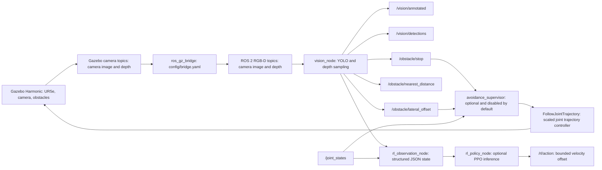
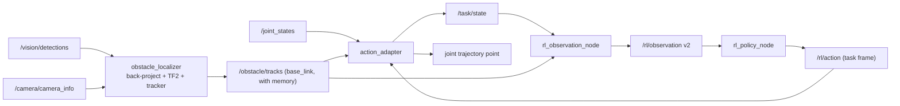

# UR Vision Avoidance

## Project overview

UR Vision Avoidance is a ROS 2 Jazzy and Gazebo Harmonic research prototype for attaching an RGB-D camera to a Universal Robots arm, detecting obstacles with Ultralytics YOLO, estimating their distance from depth data, and experimenting with learned avoidance actions.

The package is designed for perception and integration experiments. It is **not a safety-rated collision-avoidance system**, protective-stop implementation, or production robot controller. The repository includes a fixed-scene reinforcement-learning scaffold and a PPO policy trained on `ur5e_scene` (`models/ppo_ur5e_scene.zip`). Full augmented randomized domain (ARD) is still disabled; `ur5e_scene` only randomizes the obstacle position. The supplied legacy motion response remains a deterministic shoulder-pan retreat.

The default simulation uses a UR5e model starting in a well-conditioned pose, a camera mounted on the tool frame, an RGB-D camera stream, a geometric box obstacle on the task path, and a chair from Gazebo Fuel beyond the end of the path. The bundled `yolo26n.pt` checkpoint is a general pretrained model. It can detect COCO classes such as `person` and `chair`, but not the geometric box; that one is seen by the class-agnostic depth fallback of `vision_node`.

## Architecture

The process is divided into simulation, transport, perception, and optional command layers:



### Components

| Component | Responsibility |
|---|---|
| `urdf/ur_gz_camera.urdf.xacro` | Expands the UR5e description, attaches `camera_link` and `camera_optical_frame`, adds the Gazebo RGB-D sensor, and loads simulated ROS 2 control. |
| `worlds/obstacle_world.sdf` | Starts Gazebo physics, rendering, sensor processing, ground plane, chair, and box obstacle. |
| `config/bridge.yaml` | Bridges Gazebo RGB, depth, and camera-info topics into ROS 2. |
| `vision_node` | Runs YOLO on each RGB frame, samples a depth ROI inside each box, adds class-agnostic "unknown" detections for near depth regions YOLO did not explain, and publishes detection, latency and obstacle topics. |
| `avoidance_supervisor` | Listens for an obstacle request and, only when explicitly enabled, sends one bounded shoulder-pan trajectory to the simulated controller. |
| `motion_loop` | Optional fixed-waypoint simulation loop that continuously sends trajectories and pauses on `/obstacle/stop`. |
| `fixed_scene_env.py` | Provides a deterministic Gymnasium training environment for one fixed obstacle and one nominal path. ARD is disabled. |
| `train_fixed_scene.py` | Trains an optional PPO policy against the fixed-scene environment. |
| `rl_observation_node` | Combines detections and joint state into a versioned JSON observation topic. |
| `rl_policy_node` | Loads a PPO checkpoint and publishes bounded actions. It does not directly command the robot. |
| `obstacle_localizer` / `action_adapter` | 3D tracks in `base_link`; clearance-aware joint commands (see [below](#obstacle-localization-action-adapter-and-rl-contract)). |
| `metrics_node` | One row of safety/control/perception metrics per episode against `config/scene_ground_truth.yaml`. |
| `dataset_capture` | Saves RGB frames with 2D labels projected from the ground-truth boxes (for the YOLO benchmark and fine-tuning). |
| `launch/vision_bringup.launch.py` | Starts Gazebo, robot state publication, controllers, camera bridge, perception, and optional avoidance. |
| `yolo26n.pt` | Bundled Ultralytics checkpoint. A custom `best.pt` can be supplied at launch time. |

## Data flow and decisions

The camera publishes RGB and depth frames in Gazebo. `ros_gz_bridge` converts them to ROS 2 sensor messages using sensor-data QoS. `vision_node` performs inference on the RGB image and filters detections against its configured `target_classes` list.

For each retained detection, the node crops the bounding box (minus a 15% margin per side) in the depth image and takes the 25th percentile of the valid samples. Near depth regions (closer than `depth_fallback_max_m`, 0.60 m by default) that no YOLO box explains are reported as `unknown` detections with `source: depth`, so obstacles outside the detector classes or missed at short range still stop or deflect the robot. A detection is considered close when its estimated range is at or below `stop_distance_m` and its box overlaps the horizontal path region (20% to 80% of the image width) by at least `min_path_overlap_ratio`. When `require_depth` is true, stale or missing depth cannot produce a close-obstacle request.

The supervisor is disabled by default. When enabled, it reacts to a rising edge on `/obstacle/stop`, checks that joint states are fresh, checks that the trajectory action server is available, and sends a bounded shoulder-pan retreat. This behavior is intended for simulation experiments only.

The RL starter is also disabled by default. When enabled, the observation adapter publishes `/rl/observation` and the optional policy node publishes `/rl/action`. The action is an interface artifact for the starter stage; it is not connected to the UR controller. ARD is not used by the training environment, configuration, or launch mode.

## Continuous starter motion loop

The original deterministic supervisor sends one retreat after an obstacle rising edge. If you need the simulated robot to move continuously by itself while testing the perception loop, enable the separate fixed-waypoint motion loop:

```bash
ros2 launch ur_vision_avoidance vision_bringup.launch.py \
  enable_avoidance:=true \
  enable_motion_loop:=true
```

The loop cycles through four conservative joint waypoints using the `scaled_joint_trajectory_controller`. It pauses and cancels its active trajectory when `/obstacle/stop` becomes `true`, and resumes at the next waypoint after the obstacle clears. This lets you observe the sequence `motion → detection → stop → supervisor retreat → obstacle clear → motion resume`.

Monitor the loop in separate terminals:

```bash
ros2 topic echo /vision/detections std_msgs/msg/String
ros2 topic echo /obstacle/stop std_msgs/msg/Bool
ros2 topic echo /avoidance/command trajectory_msgs/msg/JointTrajectory
ros2 topic echo /joint_states sensor_msgs/msg/JointState
```

The motion loop logs messages such as `sending waypoint`, `Obstacle active: pausing motion loop`, and `Obstacle cleared: resuming motion loop`. The loop is intentionally simulation-only. It is not a collision planner, does not consume RL actions, and must not be used on a physical UR5e.

## Prerequisites

A full runtime requires the following environment:

- Ubuntu with ROS 2 Jazzy.
- Gazebo Harmonic and the `ros_gz` integration packages.
- `ros2_control` and `ros2_controllers`.
- The Universal Robots ROS 2 Gazebo simulation package.
- Xacro, `cv_bridge`, OpenCV, NumPy, and Ultralytics.
- A graphical display for Gazebo GUI and RViz, unless headless mode is selected.

The included Dockerfile installs the ROS packages and Ultralytics. Docker and Docker Compose are optional if the dependencies are already installed on the host.

### Python environment compatibility

ROS 2 console scripts must be able to import Ultralytics, `cv_bridge`, OpenCV, and NumPy from the same Python environment. A common failure is installing Ultralytics only inside `/opt/venvs/ros` and then running `ros2 run`, whose generated console script uses the system ROS Python. The node then fails before creating its publishers with:

```text
ModuleNotFoundError: No module named 'ultralytics'
```

Check the interpreter and imports from the same shell used to launch ROS:

```bash
which python3
python3 -c "import sys; print(sys.executable)"
python3 -c "from ultralytics import YOLO; print('Ultralytics OK')"
python3 -c "import cv_bridge; print('cv_bridge OK')"
```

If Ultralytics is installed in the virtual environment, source it before building and running:

```bash
source /opt/ros/jazzy/setup.bash
source /opt/venvs/ros/bin/activate
source /ros2_ws/install/setup.bash
```

The bundled Dockerfile does the latter (`ENV PYTHONPATH=/opt/venvs/ros/lib/python3.12/site-packages`): without it, `vision_node` died at start-up in the container. For a ROS container, install the package in the interpreter used by the ROS node, or expose the virtual-environment site-packages explicitly. Do not assume that activating a virtual environment in one terminal changes an already-running launch process.

### NumPy and `cv_bridge` compatibility

The ROS Jazzy `cv_bridge` binary may be compiled against NumPy 1.x. If the Ultralytics virtual environment installs NumPy 2.x, image conversion can emit this warning and later crash:

```text
A module that was compiled using NumPy 1.x cannot be run in NumPy 2.x
```

The recommended compatibility fix for this project is:

```bash
/opt/venvs/ros/bin/python -m pip install --force-reinstall numpy==1.26.4
```

Verify both interpreters before launching:

```bash
/opt/venvs/ros/bin/python -c "import numpy; print(numpy.__version__)"
python3 -c "import numpy; print(numpy.__version__)"
python3 -c "import cv_bridge; print('cv_bridge OK')"
```

They should report NumPy `1.26.4` or another NumPy 1.x version compatible with the installed ROS bridge. Pip may report that a newer `opencv-python` package prefers NumPy 2.x; for this ROS image pipeline, a coherent ROS/cv_bridge/NumPy 1.x environment is more important than mixing incompatible binary wheels. Pin the compatible versions in the Dockerfile or requirements used to build the image so the fix survives container recreation.

## Installation with Docker

From the project root, build the image:

```bash
docker compose build
```

Start the development container:

```bash
docker compose up
```

The Compose configuration uses host networking for ROS 2 discovery and mounts the project at `/ros2_ws/src/ur_vision_avoidance`. It also exposes the host display and devices for simulation. On systems that require explicit X11 permission, allow the container to connect before starting Gazebo:

```bash
xhost +local:root
```

After use, restore the display access policy if appropriate for your system:

```bash
xhost -local:root
```

Inside the container, the workspace is built and sourced automatically by the Compose command. To open a shell instead, run:

```bash
docker compose run --rm ros2jazzy-gazebo bash
source /opt/ros/jazzy/setup.bash
cd /ros2_ws
colcon build --symlink-install
source install/setup.bash
```

## Installation on a ROS 2 host

Create a workspace and place this package under `src`:

```bash
mkdir -p ~/ur_vision_ws/src
cd ~/ur_vision_ws/src
git clone <your-project-location> ur_vision_avoidance
```

Clone or install the Universal Robots Gazebo simulation package in the same workspace. The launch file expects the packages `ur_simulation_gz`, `ur_description`, and `ros_gz_sim` to be discoverable.

Install package dependencies and build:

```bash
source /opt/ros/jazzy/setup.bash
cd ~/ur_vision_ws
rosdep update
rosdep install --ignore-src --from-paths src -r -y
colcon build --symlink-install
source install/setup.bash
```

Run the package-level static checks:

```bash
cd ~/ur_vision_ws/src/ur_vision_avoidance
python3 validate_project.py
python3 -m compileall -q .
```

## Launch the simulation

The default launch starts Gazebo, the UR5e, the RGB-D camera bridge, YOLO perception, and the robot controllers. The avoidance supervisor remains disabled:

```bash
source /opt/ros/jazzy/setup.bash
source ~/ur_vision_ws/install/setup.bash
ros2 launch ur_vision_avoidance vision_bringup.launch.py
```

With Docker Compose, use the same command inside the running container:

```bash
ros2 launch ur_vision_avoidance vision_bringup.launch.py
```

To enable the simulation-only retreat supervisor:

```bash
ros2 launch ur_vision_avoidance vision_bringup.launch.py enable_avoidance:=true
```

Do not enable this mode on a physical robot. The supplied supervisor is not a validated motion planner or safety layer.

### Useful launch arguments

| Argument | Default | Purpose |
|---|---:|---|
| `ur_type` | `ur5e` | Universal Robots model supported by the installed simulation package. |
| `model` | Installed `yolo26n.pt` | Ultralytics checkpoint or absolute path to a custom checkpoint. |
| `enable_avoidance` | `false` | Enables the simulation-only retreat supervisor. |
| `gazebo_gui` | `true` | Set to `false` for server-only Gazebo execution. |
| `launch_rviz` | `true` | Starts RViz after the joint-state broadcaster. |
| `activate_joint_controller` | `true` | Starts the configured initial joint controller. |
| `initial_joint_controller` | `scaled_joint_trajectory_controller` | Controller used by the supervisor action client. |
| `world_file` | Bundled obstacle world | Alternate SDF world path. |

Example with a custom checkpoint and headless Gazebo:

```bash
ros2 launch ur_vision_avoidance vision_bringup.launch.py \
  model:=/absolute/path/to/best.pt \
  gazebo_gui:=false \
  launch_rviz:=false
```

## Inspect the running system

Use these commands in a second terminal after sourcing the workspace:

```bash
ros2 node list
ros2 topic list
ros2 topic hz /camera/image_raw
ros2 topic hz /camera/depth_image_raw
ros2 topic echo /obstacle/stop --once
ros2 topic echo /obstacle/nearest_distance --once
ros2 topic echo /vision/detections --once
ros2 action list | grep follow_joint_trajectory
ros2 control list_controllers
```

Open the annotated camera stream in RViz or `rqt_image_view`:

```bash
ros2 run rqt_image_view rqt_image_view /vision/annotated
```

The main perception topics are:

| Topic | Type | Meaning |
|---|---|---|
| `/camera/image_raw` | `sensor_msgs/msg/Image` | RGB image bridged from Gazebo. |
| `/camera/depth_image_raw` | `sensor_msgs/msg/Image` | Depth image bridged from Gazebo. |
| `/camera/camera_info` | `sensor_msgs/msg/CameraInfo` | Camera calibration information. |
| `/vision/annotated` | `sensor_msgs/msg/Image` | RGB image with YOLO annotations. |
| `/vision/detections` | `std_msgs/msg/String` | JSON-formatted detections and range estimates. |
| `/obstacle/stop` | `std_msgs/msg/Bool` | High-level close-obstacle request. |
| `/obstacle/nearest_distance` | `std_msgs/msg/Float32` | Nearest valid sampled detection range in metres, or `-1.0`. |
| `/obstacle/lateral_offset` | `std_msgs/msg/Float32` | Nearest detection center offset from the image center. |
| `/joint_states` | `sensor_msgs/msg/JointState` | Current robot joint state. |
| `/avoidance/command` | `trajectory_msgs/msg/JointTrajectory` | Debug copy of a requested retreat trajectory. |

## Detector configuration

The default detector parameters are declared in `vision_node.py`:

- Confidence threshold: `0.45`.
- Stop distance: `0.80 m`.
- RGB/depth timestamp tolerance (`sync_slop_s`): `0.08 s`.
- Depth ROI: 15% margin per side, 25th percentile, at least 20 valid samples in [0.05, 10] m.
- Depth is required for a close-obstacle decision.
- Target classes: `person`, `chair`, `bench`, `car`, `truck`, `bus`, `bicycle`, and `motorcycle` (`bench`: in Gazebo the chair is labelled "bench" at short range).
- Depth fallback: enabled, 0.60 m range, regions of at least 2% of the image, label `unknown`.
- Each `/vision/detections` message carries `inference_ms`, `processing_ms` and `age_s` (image stamp to publication).

The node can be run independently with ROS parameters if the camera topics are already available:

```bash
ros2 run ur_vision_avoidance vision_node --ros-args \
  -p model:=/absolute/path/to/best.pt \
  -p confidence:=0.50 \
  -p stop_distance_m:=0.75 \
  -p require_depth:=true
```

A custom detector should be trained for the actual objects and camera viewpoint used in the experiment. A generic COCO checkpoint is suitable for pipeline testing, but it does not establish reliable obstacle coverage.

## YOLO model comparison and selection

The repository bundles `yolo26n.pt` as a **starter checkpoint**. The table below is a practical project comparison, not a substitute for benchmarking on the target camera and hardware. Larger models generally improve difficult or unusual detections but increase inference latency and memory use.

| Model family | Relative accuracy | Relative speed and memory | Best use in this project | Main trade-off |
|---|---|---|---|---|
| `yolo26n.pt` | Lowest in the family, but often adequate for clear COCO objects | Fastest and lightest | First ROS/Gazebo integration, CPU testing, low-latency perception, fixed-scene experiments | Can miss cropped, unusual, occluded, or low-resolution chairs and obstacles |
| `yolo26s.pt` | Higher than `n` | Still suitable for near-real-time testing, but heavier | Better default candidate when the Nano model misses the chair and latency remains acceptable | More compute and latency; still not trained for project-specific obstacles |
| `yolo26m.pt` | Higher again | Medium-to-heavy | More difficult viewpoints and higher-quality offline evaluation | Greater CPU/GPU demand and control latency |
| `yolo26l.pt` | High | Heavy | Accuracy-focused simulation evaluation or GPU deployment | Usually excessive for a small embedded/ROS starter loop |
| `yolo26x.pt` | Highest capacity in the family | Heaviest and slowest | Offline comparison or powerful GPU experiments | Highest latency, memory use, and integration cost |
| YOLOv11n/s/m/l/x | Mature high-accuracy baseline with broad tooling | Nano/small variants are efficient; larger variants are heavier | Existing projects, established Ultralytics pipelines, and comparison against the current generation | Older generation; final accuracy and latency depend on the exact checkpoint and runtime |
| YOLOv8n/s/m/l/x | Mature and widely used baseline | Nano/small variants are relatively light; larger variants cost more | Reproducing older research, existing datasets, or known deployment pipelines | Older generation and may be less capable on difficult views than newer equivalents |
| YOLOv5n/s/m/l/x | Very mature baseline; still useful for legacy systems | Generally efficient, especially nano/small variants | Legacy ROS integrations, older exported ONNX/TensorRT pipelines, and compatibility testing | Older architecture, older export/runtime assumptions, and less convenient as a new project baseline |
| Custom fine-tuned model | Depends on dataset and validation | Depends on model size | Final project objects, camera viewpoint, and workspace-specific obstacle classes | Requires labeled images, training, validation, and domain coverage |

### Why `yolo26n.pt` is the best starter option

`yolo26n.pt` is the best **initial engineering choice**, not necessarily the most accurate final model:

1. **Low latency:** obstacle avoidance needs fresh observations. A larger model can improve recognition while making the command loop slower and increasing sensor-to-command delay.
2. **Low resource use:** it is more likely to run acceptably alongside Gazebo, ROS 2, `cv_bridge`, RViz, and the controller on a CPU-only SteamOS/container setup.
3. **Fast iteration:** model loading and per-frame inference are cheap enough for repeated camera, threshold, depth, and launch tests.
4. **Simple baseline:** it provides a reproducible baseline before changing both the model and the rest of the perception pipeline.
5. **Sufficient for clear benchmark objects:** it can detect standard COCO classes such as `chair` when the object is visible at a useful scale and viewpoint.

`yolo26n.pt` should be replaced or supplemented when validation shows missed detections, especially for partial chair views, unusual camera angles, transparent objects, thin structures, or project-specific geometric obstacles. Compare `yolo26s.pt` or `yolo26m.pt` using the same recorded images and measure precision, recall, inference time, end-to-end latency, and false-stop rate. A custom fine-tuned checkpoint is the correct long-term solution for the actual obstacle set; a larger generic model is not automatically safer.

### Older-version selection guidance

Older YOLO versions can still be valid choices. Prefer **YOLOv5** when an existing deployment depends on its export format or legacy inference code; prefer **YOLOv8** when reproducing a project or dataset built around that generation; and consider **YOLOv11** as a strong mature comparison baseline when the available weights, documentation, or hardware tooling are better than for the current checkpoint. Do not compare only the model name: use the same image stream, input size, confidence threshold, device, and post-processing rules.

For this repository, the practical order is:

1. Start with `yolo26n.pt` to validate ROS topics, depth sampling, controller latency, and the motion loop.
2. Compare `yolo11n.pt` or `yolo8n.pt` if an older, well-supported checkpoint is already available in your environment.
3. Try `yolo26s.pt`, `yolo11s.pt`, or `yolo8s.pt` if the Nano model misses the chair and the measured latency remains acceptable.
4. Fine-tune a project-specific model when the target objects or viewpoints are not represented well by generic COCO weights.

Model generations are not automatically interchangeable. Check the Ultralytics version, checkpoint task type, class names, image preprocessing, export format, and licensing/provenance before swapping weights. Rebuild or reinstall the runtime only when required by the checkpoint; keep the ROS `cv_bridge` and NumPy compatibility fix independent of the YOLO model comparison.

Example model comparison commands:

```bash
# Use the bundled baseline
ros2 launch ur_vision_avoidance vision_bringup.launch.py \
  model:=/absolute/path/to/yolo26n.pt

# Compare a larger checkpoint on the same camera stream
ros2 launch ur_vision_avoidance vision_bringup.launch.py \
  model:=/absolute/path/to/yolo26s.pt
```

Record `/camera/image_raw` and `/vision/detections` for each model, then compare the same frames. Do not select a model only by visual confidence; include missed obstacles, false detections, depth validity, and time from image timestamp to obstacle command.

## Fixed-scene reinforcement-learning starter

The current RL stage intentionally uses one deterministic kinematic scene. It is a starter interface for testing observation construction, action dimensions, reward behavior, and PPO training before augmented randomized domain is introduced. It does not model full Gazebo dynamics and it does not send actions to the physical or simulated UR controller.

Install the optional training dependencies:

```bash
python3 -m pip install -r requirements-rl.txt
```

Train a PPO policy using the fixed obstacle and nominal path:

```bash
python3 -m ur_vision_avoidance.train_fixed_scene \
  --timesteps 100000 \
  --seed 7 \
  --output /tmp/ur_vision_avoidance_ppo
```

The bundled `models/ppo_ur5e_scene.zip` (the default `rl_model` of the launch file) was trained with:

```bash
python3 -m ur_vision_avoidance.train_fixed_scene --scene ur5e_scene \
  --timesteps 1500000 --seed 7 --output models/ppo_ur5e_scene
```

`ur5e_scene` uses `reward: shaped` and obstacle-position jitter (see `config/rl_starter.yaml`). With the legacy reward the policy learned to stop in front of the obstacle (standing still cost about -2 per episode, trying to pass risked -100); with 500k steps the shaped reward had not converged yet (3% success on the UR5e loop), with 1.5M it reaches a mean episode reward of ~35. `rl_policy_node` loads checkpoints independently of the NumPy version used for training (the ROS image needs NumPy 1.x for `cv_bridge`).

The command produces `/tmp/ur_vision_avoidance_ppo.zip`. ARD is rejected explicitly in this starter stage:

```bash
python3 -m ur_vision_avoidance.train_fixed_scene --ard
# Expected: ARD is intentionally disabled in this fixed-scene starter stage.
```

The training environment uses a 16-element observation and a 6-element normalized action. The observation contains relative goal state, relative obstacle state, current velocity, previous action, and normalized remaining time. The action represents bounded Cartesian linear and angular offsets. The starter kinematic environment applies only the linear part; the angular dimensions preserve the planned interface for later integration.

The fixed-scene reward favors progress toward the goal, penalizes low obstacle clearance, trajectory deviation, action changes, time, and collision, and gives a goal-completion bonus. This reward is a research starting point and must be evaluated against collision rate, minimum clearance, goal success, path deviation, latency, and unnecessary avoidance.

### Run the ROS 2 RL interface

First launch perception without the old deterministic retreat:

```bash
ros2 launch ur_vision_avoidance vision_bringup.launch.py \
  enable_avoidance:=false \
  enable_rl_starter:=true \
  rl_model:=/tmp/ur_vision_avoidance_ppo.zip
```

Inspect the structured observation and bounded action:

```bash
ros2 topic echo /rl/observation --once
ros2 topic echo /rl/action --once
```

The observation adapter consumes `/task/state` (from `action_adapter`) and `/obstacle/tracks` (from `obstacle_localizer`), then publishes JSON with the schema name `ur_vision_avoidance.rl_observation.v2`. It carries the 16-element `vector` (relative goal, relative obstacle, TCP velocity, previous action, remaining time, in the task frame), the obstacle summary and the sensor ages. The policy node publishes six bounded values on `/rl/action`: three linear velocity offsets in metres per second and three angular velocity offsets in radians per second.

The policy node publishes zeros when no model is supplied, sensor data are stale, the observation is invalid, or inference fails. This conservative behavior is intentional. The conversion from `/rl/action` to joint commands is done by `action_adapter` in `rl` mode, with kinematic limits, a clearance filter, stale-data handling and a deterministic `potential_field` fallback; see the next section (it is disabled by default and sends commands only with `adapter_enable_command:=true`).

### Fixed-stage limitations

With `fixed_scene` the policy sees one fixed obstacle arrangement during training. It can memorize that arrangement and should not be expected to generalize. `ur5e_scene` adds obstacle-position jitter only (no sensor noise, latency or moving obstacles). Do not enable ARD by editing the configuration and then treat the result as validated training; ARD is a separate development stage. The next stage should add obstacle-position variation, then sensor noise and latency, and only later moving obstacles and sim-to-real evaluation.

## Obstacle localization, action adapter and RL contract

These modules close the loop between perception and motion. Everything below is **simulation-only research code**: it has been exercised with unit tests, a kinematic closed-loop simulation, mocked ROS plumbing and headless ROS 2 Jazzy + Gazebo Harmonic episodes (see [Experiments](#experiments-and-results)).



| Node | Responsibility |
|---|---|
| `obstacle_localizer` | Back-projects each detection (bounding-box centre + sampled depth) with the `CameraInfo` intrinsics, transforms it to `base_link` with the TF available **at the image timestamp** (the camera moves with the arm), and keeps persistent tracks. Tracks stay in memory for `memory_s` (default 10 s) after the obstacle leaves the field of view. Publishes `/obstacle/tracks` (JSON) and `/obstacle/markers` (RViz). Detections are dropped, never guessed, when the transform is missing. |
| `action_adapter` | Owns the episode (start pose, goal, task frame) and publishes `/task/state`. Converts motion into a joint trajectory point (damped least squares) in one of three modes: `potential_field` (deterministic avoidance), `rl` (nominal motion + `/rl/action`, falls back to `potential_field` if the action is absent) or `nominal`. The same safety layer runs in every mode. Commands reach the controller only if `enable_command` is true; otherwise they are only published on `/avoidance/adapter_command`. |
| `rl_observation_node` | Builds the 16-element observation from `/task/state`, `/obstacle/tracks` and the previous action, using `rl_contract.build_observation` - the same function the training environment uses. |
| `rl_policy_node` | Runs PPO on `/rl/observation` and publishes the bounded action. Zero action if there is no model, no obstacle, stale sensors, a wrong schema, or the obstacle is beyond `engage_distance_m` (outside the training distribution). |

### Run it

1. The robot spawns in a well-conditioned pose (`initial_positions` in the URDF: the first `motion_loop` waypoint). The upstream default (arm straight up) is singular; the adapter refuses to start there (`goal_unreachable`).

2. Launch with the adapter in observe-only mode first, and inspect it:

   ```bash
   ros2 launch ur_vision_avoidance vision_bringup.launch.py enable_action_adapter:=true
   ros2 topic echo /obstacle/tracks --once
   ros2 topic echo /task/state --once
   ros2 topic echo /avoidance/adapter_command --once
   ```

3. Only then let it move the simulated robot (do **not** combine with `enable_motion_loop` or `enable_avoidance`; they command the same controller):

   ```bash
   ros2 launch ur_vision_avoidance vision_bringup.launch.py \
     enable_action_adapter:=true adapter_enable_command:=true adapter_mode:=potential_field
   ```

4. Episodes do not start by themselves (`adapter_auto_start:=false`): start one with `ros2 topic pub --once /task/start std_msgs/msg/Empty "{}"`, stop it with `/task/stop`, restart from the current pose with `/task/reset`. Before `/task/start` the adapter sends nothing to the controller, so other tools can move the arm.

The adapter sends position-only trajectory points: the joint trajectory controller rejects a final point with non-zero velocity, which previously dropped every command in Gazebo.

Useful `action_adapter` parameters: `path_direction` (start-to-goal direction in `base_link`, default `[0, -1, 0]`), `stop_clearance_m`, `slow_clearance_m`, `influence_m`, `max_speed_mps`, `max_joint_vel_rps`, `require_fresh_perception`, `scene_section`. Check that `camera_frame` of the localizer (default `camera_optical_frame`) matches `ros2 topic echo /camera/camera_info --field header.frame_id`, and that the `base_link -> camera_optical_frame` transform exists (`ros2 run tf2_ros tf2_echo base_link camera_optical_frame`).

### RL contract: task frame and scene configuration

Observation and action are expressed relative to the TCP in a **task frame** whose x axis follows the start-to-goal path (identity in the training environment). A policy trained along +x therefore remains valid for any `path_direction`. The observation layout lives in `rl_contract.py` and is shared by training and ROS.

`config/rl_starter.yaml` is now read by the environment, the training script and the ROS nodes. `fixed_scene` reproduces the original 1.2 m scene, which is **longer than the UR5e reach (0.85 m)**; `ur5e_scene` is a scaled variant for the robot:

```bash
python3 -m ur_vision_avoidance.train_fixed_scene --scene ur5e_scene --timesteps 100000
ros2 launch ur_vision_avoidance vision_bringup.launch.py \
  enable_rl_starter:=true rl_model:=/tmp/ur_vision_avoidance_ppo.zip \
  adapter_mode:=rl adapter_enable_command:=true
```

Note that `fixed_scene` leaves only about 10 steps of slack (150 of 160) for the nominal path at the nominal speed, so any detour must also use forward speed to finish before the timeout.

### Safety layers inside the adapter

- Joint-space **whole-body filter**: for the TCP, wrist and arm sample points, the approach speed toward each obstacle is limited to a value that goes to zero at `stop_clearance_m`, and becomes a forced retreat inside it. It acts in every mode, so a policy that pushes straight at an obstacle cannot force a collision in simulation.
- Hold if an arm point is closer than `link_stop_clearance_m`, on stale joint states, on stale perception (default), on a singularity, or if the goal is not kinematically reachable at episode start.
- Cartesian speed cap, workspace floor, orientation hold, adaptive damping near singularities, joint-speed scaling and joint-limit handling.

### Verification and what it does not prove

```bash
python3 -m unittest discover -s test -p "test_*.py" -v   # no ROS, no pytest required
```

- Kinematics against the published UR5e zero pose and numerical Jacobians; tracker; back-projection round trip; avoidance primitives.
- Kinematic closed loop on the UR5e model (ideal joint integrator): 6 obstacle placements, goal reached with no collision, orientation held, limits respected, adversarial RL offsets blocked. Without the safety filter the same tests fail.
- The node classes are driven through fake `rclpy`/message/TF modules (`test/_fake_ros.py`); the tests skip themselves when a real `rclpy` is installed.

This does **not** prove behaviour under Gazebo/ROS 2: no controller dynamics, latency, camera noise, real TF or QoS are involved, and the YOLO model is not in the loop. Treat the first Gazebo run as the first real integration test.

### Known limitations

- Reactive avoidance is not complete. The arm links trail the TCP, so an obstacle that ends up "threaded" by the forearm can block the return to the path (the filter holds the arm safe rather than finishing the task). A planner (for example MoveIt or RRT*) is the proper next step. Two of 32 placements explored during development did not finish within the time limit.
- Only the TCP and wrist are actively steered; the elbow and forearm are only protected by the filter and the backstop.
- Obstacles are spheres (centre estimated by pushing the surface point back by a radius derived from the bounding box). Memory expires by time only; there is no free-space clearing, so a moved obstacle can leave a ghost until `memory_s`.
- The fixed-scene policy has one obstacle arrangement in training and no ARD; it publishes zero outside `engage_distance_m`.
- The potential field adds speed to the avoidance (about 2x faster than the filter alone in a head-on case) but the filter alone also completed all tested placements, only more slowly.

## Experiments and results

All commands run inside the Docker image (`docker compose run --rm ros2jazzy-gazebo bash`, then `source install/setup.bash`). Results below were produced on a 12-core CPU without CUDA (YOLO on CPU, Gazebo rendering in the same container), October 2026.

### Gazebo integration issues found and fixed

The first ROS 2 + Gazebo runs exposed problems that the unit and mocked tests could not see:

| Problem | Symptom | Fix |
|---|---|---|
| Console scripts use `/usr/bin/python3` | `vision_node` died with `ModuleNotFoundError: ultralytics` | `PYTHONPATH` to the venv in the Dockerfile |
| Chair at (0.80, 0, 0) enclosed the TCP at the initial pose | arm blocked on its way to the pose (controller state-tolerance abort), camera under the seat | box on the path, chair beyond its end |
| Camera mount `rpy="0 0 0"` | upside-down images; YOLO missed the chair | roll of pi on `camera_mount_joint` |
| Trajectory points with velocities | JTC rejected every adapter command ("Velocity of last trajectory point ... is not zero") | position-only points |
| Singular spawn pose + adapter holding it | arm could never be moved to a usable pose with commands enabled | `initial_positions` in the URDF, `/task/start` trigger |
| YOLO-only perception | with the chair close, no detection and the arm drove under the seat; "bench" label filtered out | class-agnostic depth fallback, `bench` target class |
| Ground box centred at z = 0 | floor surface at z = +0.05 m, chair sunk, floor regions tracked as obstacles | ground plane lowered by 0.05 m |
| PPO saved with NumPy 2 | `rl_policy_node` could not unpickle the policy under NumPy 1.x and published zeros | NumPy-independent loading |
| Fuel download at every container start | world not loaded after a transient REST error | chair cached in the image |

### Closed-loop avoidance in Gazebo

```bash
for i in 1 2 3; do
  for m in rl potential_field nominal; do
    src/ur_vision_avoidance/scripts/run_gazebo_episode.sh $m ${m}_$i 120
  done
done
python3 src/ur_vision_avoidance/scripts/summarize_metrics.py /tmp/ur_vision_avoidance_metrics/episodes.jsonl
```

| mode | n | success | collisions | min true clearance (m) | time to goal (s) | path (m) | max deviation (m) | detection age (s) | YOLO inference (ms) | depth-track error (m) |
|---|---|---|---|---|---|---|---|---|---|---|
| nominal | 3 | 3/3 | 0 | 0.025 ± 0.000 | 29.7 ± 0.1 | 0.588 ± 0.001 | 0.162 ± 0.001 | 0.039 ± 0.013 | 52 ± 9 | 0.014 ± 0.000 |
| potential_field | 4 | 4/4 | 0 | 0.068 ± 0.001 | 16.8 ± 0.2 | 0.717 ± 0.004 | 0.197 ± 0.004 | 0.052 ± 0.055 | 72 ± 45 | 0.033 ± 0.003 |
| rl | 5 | 5/5 | 0 | 0.076 ± 0.001 | 18.5 ± 8.0 | 0.910 ± 0.189 | 0.228 ± 0.001 | 0.044 ± 0.001 | 72 ± 7 | 0.037 ± 0.021 |

All 12 episodes (default world: box on the path, chair beyond it; YOLO26n + depth fallback) reached the goal with no collision against the ground-truth boxes. The potential field is repeatable (16.8 s, 6.8 cm clearance); nominal motion protected only by the safety filter is the slowest and passes closest (29.7 s, 2.5 cm). The PPO policy keeps the largest clearance (7.6 cm) but is bimodal: 2 of 5 episodes finished in 9.7 s (fastest of all), 3 of 5 took a longer detour (24.4 s, 1.05 m path). The box was only ever seen by the depth fallback (`unknown` tracks, 1.4-3.7 cm surface error); the chair, localized from YOLO boxes, had 1.8 cm (`chair`) and 4.0 cm (`bench`) error. Detection age is image stamp to publication in simulated time; YOLO inference ran at 50-70 ms per frame on the CPU (160-180 ms when a PPO training job shared the CPU).

### Decision layer on the kinematic UR5e loop

`scripts/evaluate_kinematic.py` runs 60 sphere placements (4 along the path x 5 lateral x 3 vertical, radius 0.06 m) with the same safety layer, without camera or controller dynamics:

| mode | success | collisions | min clearance (m) | mean time (s) | mean path (m) |
|---|---|---|---|---|---|
| PPO (`rl`), all 60 | 55% | 0 | 0.022 | 6.4 | 0.615 |
| PPO, 27 inside the training jitter | 67% | 0 | 0.032 | 7.0 | 0.652 |
| PPO, 33 outside | 45% | 0 | 0.022 | 5.7 | 0.570 |
| potential field, all 60 | 77% | 0 | 0.022 | 13.1 | 0.647 |
| nominal + safety filter, all 60 | 87% | 0 | 0.022 | 15.9 | 0.486 |

The safety filter prevented every collision in every mode. The policy is about twice as fast when it succeeds, but it fails more often than the deterministic baselines, mostly by stalling next to the obstacle (timeouts, not collisions), and degrades outside its training range.

### YOLO model comparison (Table 2)

```bash
src/ur_vision_avoidance/scripts/capture_dataset.sh 200 /tmp/ur_vision_avoidance_dataset
python3 src/ur_vision_avoidance/scripts/benchmark_yolo.py --dataset /tmp/ur_vision_avoidance_dataset \
  --models src/ur_vision_avoidance/yolo26n.pt models/yolo26s.pt models/yolo26m.pt models/yolo11n.pt models/yolov8n.pt \
  --alias bench=chair --device cpu
```

93 labelled frames (69 box and 90 chair instances, labels projected from `config/scene_ground_truth.yaml`, occlusion checked against depth), confidence 0.45, IoU 0.5, 640 px, CPU:

| model | chair AP50 | chair P | chair R | chair F1 | box R | latency mean / p95 (ms) |
|---|---|---|---|---|---|---|
| yolo26n | 0.753 | 1.000 | 0.133 | 0.235 | 0.000 | 63 / 246 |
| yolo26s | 0.276 | 0.556 | 0.056 | 0.101 | 0.000 | 140 / 582 |
| yolo26m | 0.072 | 1.000 | 0.011 | 0.022 | 0.000 | 341 / 852 |
| yolo11n | 0.865 | 0.886 | 0.433 | 0.582 | 0.000 | 66 / 147 |
| yolov8n | 0.903 | 1.000 | 0.389 | 0.560 | 0.000 | 63 / 203 |

No COCO checkpoint finds the geometric box (no such class): it needs a fine-tuned model (the capture writes `data.yaml` and YOLO labels) or the depth fallback. On this small, single-scene dataset the older nano models recall the chair far better than the YOLO26 family at the operating threshold. The chair labels are projections of its 3D bounding box, slightly larger than a tight 2D box, which lowers IoU for every model alike. Treat these numbers as a pipeline demonstration; a conclusive comparison needs more scenes, viewpoints and lighting.

## Troubleshooting

### No camera topics appear

Check both Gazebo Transport and ROS 2 topics:

```bash
gz topic -l | grep -E 'camera|image|depth'
ros2 topic list | grep camera
```

If Gazebo topics are absent, confirm that the world includes `gz-sim-sensors-system`, that the Xacro passed to the simulator is the custom file, and that Gazebo is not paused. If the topic prefix differs from `camera`, update `config/bridge.yaml` to match the actual Gazebo topic names.

### The annotated image is blank

First confirm that `/camera/image_raw` has a nonzero rate. Then inspect the topic type and QoS:

```bash
ros2 topic info /camera/image_raw -v
ros2 topic hz /camera/image_raw
```

Also confirm that the model path exists and that the Ultralytics checkpoint loads without an exception. A blank or incorrectly oriented camera image must be fixed before evaluating detection results.

### YOLO detects nothing

The bundled model is a general pretrained checkpoint. It may not recognize the blue geometric box in the sample world because `box` is not a standard COCO object class. Test first with the chair, lower the confidence threshold temporarily, and inspect `/vision/annotated`. For a real experiment, train a custom checkpoint using images from the mounted camera and the expected workspace.

If the node fails before `/vision/detections` exists, check the Python environment first. `ModuleNotFoundError: No module named 'ultralytics'` usually means Ultralytics was installed in a virtual environment different from the interpreter used by the ROS console script. If the node starts but crashes during `imgmsg_to_cv2` or `cv2_to_imgmsg`, check the NumPy/cv_bridge compatibility procedure above and use NumPy 1.x with the ROS Jazzy bridge.

### Distance is `-1.0`

Confirm that depth is publishing and inspect its encoding:

```bash
ros2 topic echo /camera/depth_image_raw --once
ros2 topic hz /camera/depth_image_raw
```

The node supports common `32FC1` metre depth and `16UC1` millimetre depth conventions. It rejects stale frames according to `depth_timeout_s` and ignores invalid or non-positive depth values.

### The controller action is unavailable

Check the active controllers and action names:

```bash
ros2 control list_controllers
ros2 action list | grep follow_joint_trajectory
```

The configured action is `/scaled_joint_trajectory_controller/follow_joint_trajectory`. If a different controller is active, set `initial_joint_controller` and the supervisor's `action_name` consistently. Do not send goals until the intended simulated controller is active.

### The Xacro fails

Run Xacro directly after sourcing the required workspaces:

```bash
source /opt/ros/jazzy/setup.bash
source ~/ur_vision_ws/install/setup.bash
ros2 run xacro xacro \
  ~/ur_vision_ws/src/ur_vision_avoidance/urdf/ur_gz_camera.urdf.xacro \
  ur_type:=ur5e > /tmp/ur_camera.urdf
```

Check that `ur_description`, `ur_simulation_gz`, and the requested UR model parameter files are installed.

## Extending this project toward reinforcement learning

The current supervisor should not be labeled as reinforcement learning. A real RL extension needs a defined training interface. The observation vector could combine object detections, depth ranges, camera-relative lateral offsets, robot joint positions, and joint velocities. The action space could contain bounded joint velocity commands or target poses. The environment must define reset behavior, collision and workspace constraints, reward terms, episode termination, and sensor-failure handling.

After training, the policy should be exported with a versioned checkpoint and loaded by a dedicated ROS 2 inference node. That node must enforce command limits, monitor stale observations, reject invalid actions, and provide a deterministic safe fallback. Simulation evaluation should cover empty scenes, occlusion, camera dropouts, missed detections, moving obstacles, and controller delays before any physical deployment is considered.

## Safety and deployment boundary

This repository is suitable for simulation and research integration. It is not sufficient for operating a physical UR5. A physical deployment requires risk assessment, validated sensing, collision monitoring, controller-level limits, emergency-stop integration, safe-speed configuration, and a safety-rated architecture appropriate to the application.

## Project files

- `launch/vision_bringup.launch.py`: main simulation and perception launch file.
- `ur_vision_avoidance/vision_node.py`: YOLO and RGB-D perception node.
- `ur_vision_avoidance/avoidance_supervisor.py`: optional simulation-only retreat supervisor.
- `ur_vision_avoidance/fixed_scene_env.py`: deterministic PPO training environment with ARD disabled.
- `ur_vision_avoidance/train_fixed_scene.py`: fixed-scene PPO training command.
- `ur_vision_avoidance/rl_observation_node.py`: structured ROS observation adapter.
- `ur_vision_avoidance/rl_policy_node.py`: bounded PPO inference node that does not command the robot.
- `ur_vision_avoidance/motion_loop.py`: fixed-waypoint continuous simulation loop with obstacle pause.
- `ur_vision_avoidance/obstacle_localizer_node.py`: back-projection, TF2 transform and persistent 3D obstacle tracks.
- `ur_vision_avoidance/action_adapter_node.py`: task-space motion to joint commands with the safety layer (potential field / RL / nominal).
- `ur_vision_avoidance/avoidance_logic.py`, `ur_kinematics.py`, `obstacle_tracker.py`, `camera_geometry.py`: ROS-free logic used by the nodes.
- `ur_vision_avoidance/rl_contract.py`, `scene_config.py`: shared observation layout, task frame and scene loading.
- `ur_vision_avoidance/depth_fallback.py`: class-agnostic near-region detection on the depth image.
- `ur_vision_avoidance/metrics.py`, `metrics_node.py`: episode metrics against the scene ground truth.
- `ur_vision_avoidance/dataset_labels.py`, `dataset_capture_node.py`: auto-labelled dataset capture.
- `scripts/run_gazebo_episode.sh`, `scripts/capture_dataset.sh`: headless Gazebo experiments.
- `scripts/evaluate_kinematic.py`, `scripts/benchmark_yolo.py`: decision-layer comparison and YOLO model comparison.
- `config/scene_ground_truth.yaml`: obstacle boxes of the world, in `base_link`.
- `models/ppo_ur5e_scene.zip`: PPO policy trained on `ur5e_scene`.
- `test/`: unit tests, closed-loop kinematic simulation and mocked-ROS node tests (`python3 -m unittest discover -s test`).
- `urdf/ur_gz_camera.urdf.xacro`: UR5e plus camera description.
- `worlds/obstacle_world.sdf`: Gazebo test world.
- `config/bridge.yaml`: Gazebo-to-ROS topic bridge configuration.
- `config/rl_starter.yaml`: fixed-scene RL settings; `ard_enabled` is `false`.
- `requirements-rl.txt`: optional Gymnasium and Stable-Baselines3 dependencies.
- `validate_project.py`: static project consistency checks.
- `ROS2_Jazzy_UR_Gazebo_DeepLearning_Obstacle_Avoidance_Tutorial.md`: extended background tutorial.
- `AUDIT_REPORT.md`: archive audit findings and applied corrections.

## References

[1]: https://docs.ros.org/en/jazzy/ "ROS 2 Jazzy documentation"
[2]: https://gazebosim.org/docs/harmonic/ "Gazebo Harmonic documentation"
[3]: https://github.com/UniversalRobots/Universal_Robots_ROS2_GZ_Simulation "Universal Robots ROS 2 Gazebo Simulation"
[4]: https://docs.ultralytics.com/modes/predict/ "Ultralytics prediction documentation"
[5]: https://docs.ros.org/en/jazzy/p/ros_gz_bridge/ "ROS-Gazebo bridge documentation"
