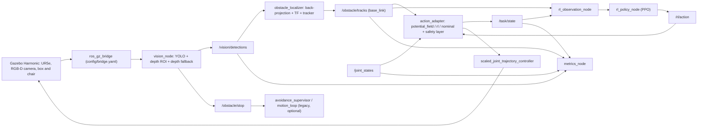
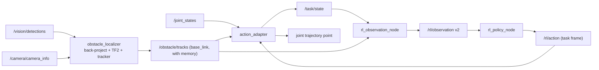

# UR Vision Avoidance

## Project overview

UR Vision Avoidance is a ROS 2 Jazzy and Gazebo Harmonic research prototype for attaching an RGB-D camera to a Universal Robots arm, detecting obstacles with Ultralytics YOLO, estimating their distance from depth data, and experimenting with learned avoidance actions.

The package is designed for perception and integration experiments. It is **not a safety-rated collision-avoidance system**, protective-stop implementation, or production robot controller. The repository includes a fixed-scene reinforcement-learning scaffold and a PPO policy trained on `ur5e_scene` (`models/ppo_ur5e_scene.zip`). Full augmented randomized domain (ARD) is still disabled; `ur5e_scene` only randomizes the obstacle position. The supplied legacy motion response remains a deterministic shoulder-pan retreat.

The default simulation uses a UR5e model starting in a well-conditioned pose, a camera mounted on the tool frame, an RGB-D camera stream, a geometric box obstacle on the task path, and a chair from Gazebo Fuel beyond the end of the path. The bundled `yolo26n.pt` checkpoint is a general pretrained model. It can detect COCO classes such as `person` and `chair`, but not the geometric box; that one is seen by the class-agnostic depth fallback of `vision_node`.

## Quick start

Everything runs inside the Docker image (ROS 2 Jazzy, Gazebo Harmonic, Ultralytics, Stable-Baselines3). From the repository root:

```bash
docker compose build
```

```bash
xhost +local:root
```

```bash
docker compose up -d
```

```bash
docker compose exec ros2jazzy-gazebo bash
```

Inside the container, start the simulation with obstacle avoidance enabled:

```bash
ros2 launch ur_vision_avoidance vision_bringup.launch.py enable_action_adapter:=true adapter_enable_command:=true adapter_mode:=potential_field
```

In a second container shell (`docker compose exec ros2jazzy-gazebo bash` again), start an episode:

```bash
ros2 topic pub --once /task/start std_msgs/msg/Empty "{}"
```

The arm moves 0.45 m along -y, detects the blue box on its path through the depth fallback, goes around it and stops at the goal. See [Running the test scenario](#running-the-test-scenario) for the full procedure and [Running the tests](#running-the-tests) for the automated checks.

## Architecture

The process is divided into simulation, transport, perception, localization, decision and evaluation layers:



### Components

| Component | Responsibility |
|---|---|
| `urdf/ur_gz_camera.urdf.xacro` | Expands the UR5e description, attaches `camera_link` and `camera_optical_frame`, adds the Gazebo RGB-D sensor, and loads simulated ROS 2 control. |
| `worlds/obstacle_world.sdf` | Starts Gazebo physics, rendering, sensor processing, ground plane, chair, and box obstacle. |
| `config/bridge.yaml` | Bridges Gazebo RGB, depth, and camera-info topics into ROS 2. |
| `vision_node` | Runs YOLO on each RGB frame, samples a depth ROI inside each box, adds class-agnostic "unknown" detections for near depth regions YOLO did not explain, and publishes detection, latency and obstacle topics. |
| `avoidance_supervisor` | Listens for an obstacle request and, only when explicitly enabled, sends one bounded shoulder-pan trajectory to the simulated controller. |
| `motion_loop` | Optional fixed-waypoint simulation loop that continuously sends trajectories and pauses on `/obstacle/stop`. |
| `fixed_scene_env.py` | Provides a deterministic Gymnasium training environment for one fixed obstacle and one nominal path. ARD is disabled. |
| `train_fixed_scene.py` | Trains an optional PPO policy against the fixed-scene environment. |
| `rl_observation_node` | Combines detections and joint state into a versioned JSON observation topic. |
| `rl_policy_node` | Loads a PPO checkpoint and publishes bounded actions. It does not directly command the robot. |
| `obstacle_localizer` / `action_adapter` | 3D tracks in `base_link`; clearance-aware joint commands (see [below](#obstacle-localization-and-action-adapter)). |
| `metrics_node` | One row of safety/control/perception metrics per episode against `config/scene_ground_truth.yaml`. |
| `dataset_capture` | Saves RGB frames with 2D labels projected from the ground-truth boxes (for the YOLO benchmark and fine-tuning). |
| `launch/vision_bringup.launch.py` | Starts Gazebo, robot state publication, controllers, camera bridge, perception, and optional avoidance. |
| `yolo26n.pt` | Bundled Ultralytics checkpoint. A custom `best.pt` can be supplied at launch time. |

## Data flow and decisions

The camera publishes RGB and depth frames in Gazebo. `ros_gz_bridge` converts them to ROS 2 sensor messages using sensor-data QoS. `vision_node` performs inference on the RGB image and filters detections against its configured `target_classes` list.

For each retained detection, the node crops the bounding box (minus a 15% margin per side) in the depth image and takes the 25th percentile of the valid samples. Near depth regions (closer than `depth_fallback_max_m`, 0.60 m by default) that no YOLO box explains are reported as `unknown` detections with `source: depth`, so obstacles outside the detector classes or missed at short range still stop or deflect the robot. A detection is considered close when its estimated range is at or below `stop_distance_m` and its box overlaps the horizontal path region (20% to 80% of the image width) by at least `min_path_overlap_ratio`. When `require_depth` is true, stale or missing depth cannot produce a close-obstacle request.

The supervisor is disabled by default. When enabled, it reacts to a rising edge on `/obstacle/stop`, checks that joint states are fresh, checks that the trajectory action server is available, and sends a bounded shoulder-pan retreat. This behavior is intended for simulation experiments only.

The localizer turns detections into persistent 3D tracks in `base_link`. The `action_adapter` owns the episode (start, goal, task frame) and converts the chosen decision (potential field, PPO offset on `/rl/action`, or nominal motion) into joint commands through the same safety layer. RL nodes are disabled by default (`enable_rl_starter:=false`); full ARD is not used.

## Installation

### Option A: Docker (recommended)

Requirements on the host: Docker Engine with the Compose plugin, an X11 display for the Gazebo GUI and RViz (not needed for headless runs), and network access during the build. Your user must be allowed to use Docker (member of the `docker` group).

Build the image once, and again after any change to the `Dockerfile`:

```bash
docker compose build
```

The image contains ROS 2 Jazzy (desktop), Gazebo Harmonic with `ros_gz`, `ros2_control`, the Universal Robots description and Gazebo simulation packages, a venv at `/opt/venvs/ros` with Ultralytics, Gymnasium, Stable-Baselines3 and NumPy 1.26.4 (required by the ROS `cv_bridge`), and a cached copy of the Fuel chair used by the world. `PYTHONPATH` points ROS console scripts at the venv, so `ros2 run` and `ros2 launch` can import Ultralytics and Stable-Baselines3.

Allow the container to open windows on your display (undo later with `xhost -local:root`):

```bash
xhost +local:root
```

Start the development container in the background. The Compose command builds the workspace (`colcon build --symlink-install`) and then waits in a shell:

```bash
docker compose up -d
```

Follow the start-up until it prints `ROS environment ready`:

```bash
docker compose logs -f ros2jazzy-gazebo
```

Open as many shells in the container as you need. Interactive shells source ROS, the venv and the workspace automatically:

```bash
docker compose exec ros2jazzy-gazebo bash
```

`ros2` exists only inside the container: running `ros2 ...` on the host gives `ros2: command not found`. To send a single command from the host without opening a shell:

```bash
docker compose exec ros2jazzy-gazebo bash -lc "ros2 topic pub --once /task/start std_msgs/msg/Empty '{}'"
```

The repository is bind-mounted at `/ros2_ws/src/ur_vision_avoidance` and the workspace is built with `--symlink-install`, so edits to existing Python files apply on the next node start. After adding files, console scripts or data files (launch, config, worlds, models), rebuild inside the container:

```bash
cd /ros2_ws && colcon build --symlink-install --packages-select ur_vision_avoidance && source install/setup.bash
```

Stop and remove the container when you are done:

```bash
docker compose down
```

For one-off, non-interactive runs (scripts, CI), use a temporary container instead of the long-running one. The workspace inside the image is a snapshot taken at `docker compose build`, so one-off commands rebuild the package first to pick up the mounted sources:

```bash
docker compose run --rm -T ros2jazzy-gazebo bash -lc "colcon build --symlink-install --packages-select ur_vision_avoidance >/dev/null && source install/setup.bash && <command>"
```

### Option B: native ROS 2 Jazzy host

Requirements: Ubuntu 24.04 with ROS 2 Jazzy, Gazebo Harmonic, `ros-jazzy-ros-gz`, `ros-jazzy-ros2-control`, `ros-jazzy-ros2-controllers`, `ros-jazzy-gz-ros2-control`, `ros-jazzy-ur`, `ros-jazzy-xacro`, `ros-jazzy-cv-bridge`, `ros-jazzy-message-filters`.

Create a workspace with this package and the UR Gazebo simulation package:

```bash
mkdir -p ~/ur_vision_ws/src && cd ~/ur_vision_ws/src
git clone https://github.com/Druwing/ur_vision_avoidance.git
git clone -b jazzy https://github.com/UniversalRobots/Universal_Robots_ROS2_GZ_Simulation.git ur_simulation_gz
```

Install the Python packages into the interpreter that runs the ROS nodes (`/usr/bin/python3`), or into a venv exposed through `PYTHONPATH` as the Dockerfile does. Keep NumPy 1.x for `cv_bridge`:

```bash
python3 -m pip install --break-system-packages "numpy==1.26.4" ultralytics "gymnasium>=0.29,<1.1" "stable-baselines3>=2.3,<3.0"
```

Resolve ROS dependencies, build and source:

```bash
source /opt/ros/jazzy/setup.bash
cd ~/ur_vision_ws
rosdep update
rosdep install --ignore-src --from-paths src -r -y
colcon build --symlink-install
source install/setup.bash
```

Run the static checks:

```bash
python3 ~/ur_vision_ws/src/ur_vision_avoidance/validate_project.py
```

### Python environment notes

#### Python environment compatibility

ROS 2 console scripts must be able to import Ultralytics, `cv_bridge`, OpenCV, and NumPy from the same Python environment. A common failure is installing Ultralytics only inside `/opt/venvs/ros` and then running `ros2 run`, whose generated console script uses the system ROS Python. The node then fails before creating its publishers with:

```text
ModuleNotFoundError: No module named 'ultralytics'
```

Check the interpreter and imports from the same shell used to launch ROS:

```bash
which python3
python3 -c "import sys; print(sys.executable)"
python3 -c "from ultralytics import YOLO; print('Ultralytics OK')"
python3 -c "import cv_bridge; print('cv_bridge OK')"
```

If Ultralytics is installed in the virtual environment, source it before building and running:

```bash
source /opt/ros/jazzy/setup.bash
source /opt/venvs/ros/bin/activate
source /ros2_ws/install/setup.bash
```

The bundled Dockerfile does the latter (`ENV PYTHONPATH=/opt/venvs/ros/lib/python3.12/site-packages`): without it, `vision_node` died at start-up in the container. For a ROS container, install the package in the interpreter used by the ROS node, or expose the virtual-environment site-packages explicitly. Do not assume that activating a virtual environment in one terminal changes an already-running launch process.

#### NumPy and `cv_bridge` compatibility

The ROS Jazzy `cv_bridge` binary may be compiled against NumPy 1.x. If the Ultralytics virtual environment installs NumPy 2.x, image conversion can emit this warning and later crash:

```text
A module that was compiled using NumPy 1.x cannot be run in NumPy 2.x
```

The recommended compatibility fix for this project is:

```bash
/opt/venvs/ros/bin/python -m pip install --force-reinstall numpy==1.26.4
```

Verify both interpreters before launching:

```bash
/opt/venvs/ros/bin/python -c "import numpy; print(numpy.__version__)"
python3 -c "import numpy; print(numpy.__version__)"
python3 -c "import cv_bridge; print('cv_bridge OK')"
```

They should report NumPy `1.26.4` or another NumPy 1.x version compatible with the installed ROS bridge. Pip may report that a newer `opencv-python` package prefers NumPy 2.x; for this ROS image pipeline, a coherent ROS/cv_bridge/NumPy 1.x environment is more important than mixing incompatible binary wheels. Pin the compatible versions in the Dockerfile or requirements used to build the image so the fix survives container recreation.

## Running the environment

All commands in this section run inside the container (or a sourced native workspace).

### Launch modes

| Goal | Command |
|---|---|
| Perception only (Gazebo, camera, YOLO, localizer) | `ros2 launch ur_vision_avoidance vision_bringup.launch.py` |
| Headless perception (no Gazebo GUI, no RViz) | `ros2 launch ur_vision_avoidance vision_bringup.launch.py gazebo_gui:=false launch_rviz:=false` |
| Adapter in observe-only mode (commands only on `/avoidance/adapter_command`) | `ros2 launch ur_vision_avoidance vision_bringup.launch.py enable_action_adapter:=true` |
| Potential-field avoidance moving the robot | `ros2 launch ur_vision_avoidance vision_bringup.launch.py enable_action_adapter:=true adapter_enable_command:=true adapter_mode:=potential_field` |
| PPO policy moving the robot (bundled policy) | `ros2 launch ur_vision_avoidance vision_bringup.launch.py enable_rl_starter:=true adapter_mode:=rl adapter_enable_command:=true` |
| Nominal motion protected only by the safety filter | `ros2 launch ur_vision_avoidance vision_bringup.launch.py enable_action_adapter:=true adapter_enable_command:=true adapter_mode:=nominal` |
| Any of the above with per-episode metrics | add `enable_metrics:=true run_label:=<name>` |
| Legacy retreat supervisor | `ros2 launch ur_vision_avoidance vision_bringup.launch.py enable_avoidance:=true` |
| Legacy waypoint loop + supervisor | `ros2 launch ur_vision_avoidance vision_bringup.launch.py enable_avoidance:=true enable_motion_loop:=true` |

Only one node may command the controller at a time: do not combine `adapter_enable_command:=true` with `enable_avoidance` or `enable_motion_loop`.

The robot spawns in a well-conditioned pose, `q = [0, -1.2, 1.4, -1.7, -1.57, 0]` (`initial_positions` in the URDF), with the TCP at (0.631, 0.133, 0.374) in `base_link` and the camera looking along -y. No manual "move to home" step is needed.

### Launch arguments

| Argument | Default | Purpose |
|---|---:|---|
| `ur_type` | `ur5e` | Universal Robots model. |
| `model` | installed `yolo26n.pt` | YOLO checkpoint (path). |
| `device` | `""` (auto) | Ultralytics device: `cpu`, `0`, ... |
| `confidence` | `0.45` | YOLO confidence threshold. |
| `stop_distance_m` | `0.80` | Range at or below which an in-path detection requests a stop. |
| `sync_slop_s` | `0.08` | Maximum RGB/depth timestamp difference. |
| `depth_roi_margin_ratio` / `depth_percentile` | `0.15` / `25.0` | Depth sampling inside each box. |
| `min_path_overlap_ratio` | `0.15` | Minimum overlap of a box with the image path region. |
| `depth_fallback_enabled` | `true` | Report near depth regions YOLO did not explain as `unknown`. |
| `depth_fallback_max_m` | `0.60` | Range of the depth fallback. |
| `enable_action_adapter` | `false` | Run `action_adapter` (also started by `enable_rl_starter`). |
| `adapter_mode` | `potential_field` | `potential_field`, `rl` or `nominal`. |
| `adapter_enable_command` | `false` | Send adapter commands to the controller (simulation only). |
| `adapter_auto_start` | `false` | Start an episode at launch instead of waiting for `/task/start`. |
| `path_direction` | `[0.0, -1.0, 0.0]` | Start-to-goal direction in `base_link` (defines the task frame). |
| `scene_section` | `ur5e_scene` | Section of `config/rl_starter.yaml` used by the adapter and RL nodes. |
| `enable_rl_starter` | `false` | Run `rl_observation_node` and `rl_policy_node`. |
| `rl_model` | installed `ppo_ur5e_scene.zip` | PPO policy; empty publishes zero actions. |
| `enable_metrics` | `false` | Run `metrics_node`. |
| `metrics_output_dir` | `/tmp/ur_vision_avoidance_metrics` | Where `episodes.csv` / `episodes.jsonl` are written. |
| `run_label` | `""` | Free text stored with every metrics row. |
| `enable_avoidance` / `enable_motion_loop` | `false` | Legacy supervisor / waypoint loop. |
| `gazebo_gui` / `launch_rviz` | `true` | Set to `false` for headless runs. |
| `world_file` | bundled `obstacle_world.sdf` | Alternate SDF world (update `config/scene_ground_truth.yaml` accordingly). |
| `description_file` | bundled Xacro | Alternate robot description. |
| `activate_joint_controller` / `initial_joint_controller` | `true` / `scaled_joint_trajectory_controller` | Controller started at launch. |

### Inspect the running system

```bash
ros2 node list
ros2 control list_controllers
ros2 topic hz /camera/image_raw
ros2 topic echo /vision/detections --once
ros2 topic echo /obstacle/tracks --once
ros2 topic echo /task/state --once
ros2 run rqt_image_view rqt_image_view /vision/annotated
ros2 run tf2_ros tf2_echo base_link camera_optical_frame
```

In `/vision/annotated`, YOLO boxes are drawn by Ultralytics and depth-fallback regions are orange rectangles labelled `unknown <distance>`. In RViz, add a `MarkerArray` display on `/obstacle/markers` to see the tracks (red: visible, orange: remembered).

| Topic | Type | Meaning |
|---|---|---|
| `/camera/image_raw`, `/camera/depth_image_raw`, `/camera/camera_info` | `sensor_msgs` | RGB-D stream bridged from Gazebo. |
| `/vision/annotated` | `sensor_msgs/msg/Image` | RGB with YOLO and depth-fallback boxes. |
| `/vision/detections` | `std_msgs/msg/String` | JSON: detections (`class`, `source` yolo/depth, `bbox_xyxy`, `distance_m`, `in_path`, `close`), `inference_ms`, `processing_ms`, `age_s`. |
| `/obstacle/stop` | `std_msgs/msg/Bool` | Close in-path obstacle (legacy supervisor and motion loop). |
| `/obstacle/nearest_distance`, `/obstacle/lateral_offset` | `std_msgs/msg/Float32` | Nearest detection range and image offset. |
| `/obstacle/tracks` | `std_msgs/msg/String` | JSON: 3D tracks in `base_link` (position, surface, radius, velocity, visible). |
| `/obstacle/markers` | `visualization_msgs/msg/MarkerArray` | Tracks for RViz. |
| `/task/state` | `std_msgs/msg/String` | JSON: TCP, start, goal, task frame, `status`, `mode`, `reached`, `min_clearance_m`. |
| `/task/start`, `/task/stop`, `/task/reset` | `std_msgs/msg/Empty` | Episode control (inputs). |
| `/rl/observation`, `/rl/action` | `String`, `Float32MultiArray` | RL observation (16 values) and bounded action (6 values). |
| `/avoidance/adapter_command` | `trajectory_msgs/msg/JointTrajectory` | Copy of every adapter command (also in observe-only mode). |
| `/metrics/episode` | `std_msgs/msg/String` | JSON summary of each finished episode. |
| `/joint_states` | `sensor_msgs/msg/JointState` | Robot joint state. |

### Legacy continuous motion loop

The original deterministic supervisor sends one retreat after an obstacle rising edge. If you need the simulated robot to move continuously by itself while testing the perception loop, enable the separate fixed-waypoint motion loop:

```bash
ros2 launch ur_vision_avoidance vision_bringup.launch.py \
  enable_avoidance:=true \
  enable_motion_loop:=true
```

The loop cycles through four conservative joint waypoints using the `scaled_joint_trajectory_controller`. It pauses and cancels its active trajectory when `/obstacle/stop` becomes `true`, and resumes at the next waypoint after the obstacle clears. This lets you observe the sequence `motion → detection → stop → supervisor retreat → obstacle clear → motion resume`.

Monitor the loop in separate container shells:

```bash
ros2 topic echo /vision/detections std_msgs/msg/String
ros2 topic echo /obstacle/stop std_msgs/msg/Bool
ros2 topic echo /avoidance/command trajectory_msgs/msg/JointTrajectory
ros2 topic echo /joint_states sensor_msgs/msg/JointState
```

The motion loop logs messages such as `sending waypoint`, `Obstacle active: pausing motion loop`, and `Obstacle cleared: resuming motion loop`. The loop is intentionally simulation-only. It is not a collision planner, does not consume RL actions, and must not be used on a physical UR5e.

## Running the test scenario

### Scene

`worlds/obstacle_world.sdf` (world == `base_link`), mirrored in `config/scene_ground_truth.yaml`:

| Element | Pose / size | Role |
|---|---|---|
| UR5e | origin, spawned at `q = [0, -1.2, 1.4, -1.7, -1.57, 0]` | TCP at (0.631, 0.133, 0.374), camera on the tool looking along -y |
| Task path | 0.45 m along -y from the TCP (`ur5e_scene`, `path_direction`) | goal at (0.631, -0.317, 0.374) |
| `box_obstacle` | 0.10 m cube at (0.63, -0.09, 0.37) | on the path, 0.22 m ahead; not a COCO class, detected by the depth fallback |
| `chair_obstacle` (Fuel) | at (0.65, -1.10, 0) | beyond the goal, visible, detected by YOLO as `chair` / `bench` |

### Interactive run

1. Start the simulation with the adapter commanding the robot (choose `adapter_mode:=potential_field`, `nominal`, or use the PPO launch line from [Launch modes](#launch-modes)). Add `enable_metrics:=true` to record the episode:

```bash
ros2 launch ur_vision_avoidance vision_bringup.launch.py enable_action_adapter:=true adapter_enable_command:=true adapter_mode:=potential_field enable_metrics:=true
```

2. In another container shell, wait until perception and tracks are up. `/task/state` shows `"status":"waiting_start"` and `/obstacle/tracks` contains an `unknown` track at the box:

```bash
ros2 topic echo /obstacle/tracks --once
```

3. Start the episode:

```bash
ros2 topic pub --once /task/start std_msgs/msg/Empty "{}"
```

4. Watch the arm go around the box and stop at the goal. Follow the state:

```bash
ros2 topic echo /task/state --field data
```

`status` is `ok` while moving and `goal_reached` at the end. Other values: `perception_stale` and `stale_joint_state` (holding on missing data), `goal_unreachable` (the goal of this episode is outside the well-conditioned workspace), `waiting_start`.

5. With `enable_metrics:=true`, the result is published on `/metrics/episode` and appended to `/tmp/ur_vision_avoidance_metrics/episodes.csv` and `episodes.jsonl`.

### Repeating an episode

`/task/reset` restarts the episode **from the current pose**, with a new goal 0.45 m further along the path. After a completed episode that goal is out of reach and the adapter holds (`goal_unreachable`). To repeat the experiment from the initial pose, stop the episode (otherwise the adapter keeps commanding "hold"), send the arm back, and start again:

```bash
ros2 topic pub --once /task/stop std_msgs/msg/Empty "{}"
```

```bash
ros2 topic pub --once /scaled_joint_trajectory_controller/joint_trajectory trajectory_msgs/msg/JointTrajectory "{joint_names: [shoulder_pan_joint, shoulder_lift_joint, elbow_joint, wrist_1_joint, wrist_2_joint, wrist_3_joint], points: [{positions: [0.0, -1.2, 1.4, -1.7, -1.57, 0.0], time_from_start: {sec: 5}}]}"
```

Wait about 6 s, then:

```bash
ros2 topic pub --once /task/start std_msgs/msg/Empty "{}"
```

Restarting the launch also returns the robot to the initial pose.

### Headless, scripted episodes

`scripts/run_gazebo_episode.sh <mode> [run_label] [timeout_s]` starts a headless simulation, checks that `/joint_states` and `/vision/detections` are published (restarting the simulation up to 3 times if the controller spawners time out), sends `/task/start`, waits for the metrics row and shuts everything down. From the host:

```bash
docker compose run --rm -T ros2jazzy-gazebo bash -lc "colcon build --symlink-install --packages-select ur_vision_avoidance >/dev/null && source install/setup.bash && src/ur_vision_avoidance/scripts/run_gazebo_episode.sh potential_field pf_1"
```

Environment variables: `OUT` (metrics directory, default `/tmp/ur_vision_avoidance_metrics`), `MODEL` (YOLO checkpoint), `EXTRA` (extra launch arguments), `SNAPSHOT=1` (save `/vision/annotated` at the start). Results accumulate in `$OUT/episodes.jsonl`; summarize them per mode with:

```bash
python3 src/ur_vision_avoidance/scripts/summarize_metrics.py /tmp/ur_vision_avoidance_metrics/episodes.jsonl
```

### Metrics recorded per episode

| Group | Fields |
|---|---|
| Safety | `collision`, `min_true_clearance_m` (robot sample points and camera vs. ground-truth boxes), `min_estimated_clearance_m` (adapter's view) |
| Control | `outcome` (`reached`, `timeout`, `stopped`, `restarted`, `shutdown`), `time_to_goal_s`, `path_length_m`, `max_deviation_m`, `status_time_s` |
| Perception | `frames`, `stop_frame_ratio`, `detection_age_s` and `inference_ms` (mean / p95 / max), `detections_by_source` |
| Localization | `track_surface_error_m` and `track_surface_error_by_label_m`: distance of each visible track's surface point to the nearest ground-truth box |

## Detector configuration

The default detector parameters are declared in `vision_node.py`:

- Confidence threshold: `0.45`.
- Stop distance: `0.80 m`.
- RGB/depth timestamp tolerance (`sync_slop_s`): `0.08 s`.
- Depth ROI: 15% margin per side, 25th percentile, at least 20 valid samples in [0.05, 10] m.
- Depth is required for a close-obstacle decision.
- Target classes: `person`, `chair`, `bench`, `car`, `truck`, `bus`, `bicycle`, and `motorcycle` (`bench`: in Gazebo the chair is labelled "bench" at short range).
- Depth fallback: enabled, 0.60 m range, regions of at least 2% of the image, label `unknown`.
- Each `/vision/detections` message carries `inference_ms`, `processing_ms` and `age_s` (image stamp to publication).

The node can be run independently with ROS parameters if the camera topics are already available:

```bash
ros2 run ur_vision_avoidance vision_node --ros-args \
  -p model:=/absolute/path/to/best.pt \
  -p confidence:=0.50 \
  -p stop_distance_m:=0.75 \
  -p require_depth:=true
```

A custom detector should be trained for the actual objects and camera viewpoint used in the experiment. A generic COCO checkpoint is suitable for pipeline testing, but it does not establish reliable obstacle coverage.

## YOLO model comparison and selection

The repository bundles `yolo26n.pt` as a **starter checkpoint**. The table below is a practical project comparison, not a substitute for benchmarking on the target camera and hardware. Larger models generally improve difficult or unusual detections but increase inference latency and memory use.

| Model family | Relative accuracy | Relative speed and memory | Best use in this project | Main trade-off |
|---|---|---|---|---|
| `yolo26n.pt` | Lowest in the family, but often adequate for clear COCO objects | Fastest and lightest | First ROS/Gazebo integration, CPU testing, low-latency perception, fixed-scene experiments | Can miss cropped, unusual, occluded, or low-resolution chairs and obstacles |
| `yolo26s.pt` | Higher than `n` | Still suitable for near-real-time testing, but heavier | Better default candidate when the Nano model misses the chair and latency remains acceptable | More compute and latency; still not trained for project-specific obstacles |
| `yolo26m.pt` | Higher again | Medium-to-heavy | More difficult viewpoints and higher-quality offline evaluation | Greater CPU/GPU demand and control latency |
| `yolo26l.pt` | High | Heavy | Accuracy-focused simulation evaluation or GPU deployment | Usually excessive for a small embedded/ROS starter loop |
| `yolo26x.pt` | Highest capacity in the family | Heaviest and slowest | Offline comparison or powerful GPU experiments | Highest latency, memory use, and integration cost |
| YOLOv11n/s/m/l/x | Mature high-accuracy baseline with broad tooling | Nano/small variants are efficient; larger variants are heavier | Existing projects, established Ultralytics pipelines, and comparison against the current generation | Older generation; final accuracy and latency depend on the exact checkpoint and runtime |
| YOLOv8n/s/m/l/x | Mature and widely used baseline | Nano/small variants are relatively light; larger variants cost more | Reproducing older research, existing datasets, or known deployment pipelines | Older generation and may be less capable on difficult views than newer equivalents |
| YOLOv5n/s/m/l/x | Very mature baseline; still useful for legacy systems | Generally efficient, especially nano/small variants | Legacy ROS integrations, older exported ONNX/TensorRT pipelines, and compatibility testing | Older architecture, older export/runtime assumptions, and less convenient as a new project baseline |
| Custom fine-tuned model | Depends on dataset and validation | Depends on model size | Final project objects, camera viewpoint, and workspace-specific obstacle classes | Requires labeled images, training, validation, and domain coverage |

### Why `yolo26n.pt` is the best starter option

`yolo26n.pt` is the best **initial engineering choice**, not necessarily the most accurate final model:

1. **Low latency:** obstacle avoidance needs fresh observations. A larger model can improve recognition while making the command loop slower and increasing sensor-to-command delay.
2. **Low resource use:** it is more likely to run acceptably alongside Gazebo, ROS 2, `cv_bridge`, RViz, and the controller on a CPU-only SteamOS/container setup.
3. **Fast iteration:** model loading and per-frame inference are cheap enough for repeated camera, threshold, depth, and launch tests.
4. **Simple baseline:** it provides a reproducible baseline before changing both the model and the rest of the perception pipeline.
5. **Sufficient for clear benchmark objects:** it can detect standard COCO classes such as `chair` when the object is visible at a useful scale and viewpoint.

`yolo26n.pt` should be replaced or supplemented when validation shows missed detections, especially for partial chair views, unusual camera angles, transparent objects, thin structures, or project-specific geometric obstacles. Compare `yolo26s.pt` or `yolo26m.pt` using the same recorded images and measure precision, recall, inference time, end-to-end latency, and false-stop rate. A custom fine-tuned checkpoint is the correct long-term solution for the actual obstacle set; a larger generic model is not automatically safer.

### Older-version selection guidance

Older YOLO versions can still be valid choices. Prefer **YOLOv5** when an existing deployment depends on its export format or legacy inference code; prefer **YOLOv8** when reproducing a project or dataset built around that generation; and consider **YOLOv11** as a strong mature comparison baseline when the available weights, documentation, or hardware tooling are better than for the current checkpoint. Do not compare only the model name: use the same image stream, input size, confidence threshold, device, and post-processing rules.

For this repository, the practical order is:

1. Start with `yolo26n.pt` to validate ROS topics, depth sampling, controller latency, and the motion loop.
2. Compare `yolo11n.pt` or `yolo8n.pt` if an older, well-supported checkpoint is already available in your environment.
3. Try `yolo26s.pt`, `yolo11s.pt`, or `yolo8s.pt` if the Nano model misses the chair and the measured latency remains acceptable.
4. Fine-tune a project-specific model when the target objects or viewpoints are not represented well by generic COCO weights.

Model generations are not automatically interchangeable. Check the Ultralytics version, checkpoint task type, class names, image preprocessing, export format, and licensing/provenance before swapping weights. Rebuild or reinstall the runtime only when required by the checkpoint; keep the ROS `cv_bridge` and NumPy compatibility fix independent of the YOLO model comparison.

Example model comparison commands:

```bash
# Use the bundled baseline
ros2 launch ur_vision_avoidance vision_bringup.launch.py \
  model:=/absolute/path/to/yolo26n.pt

# Compare a larger checkpoint on the same camera stream
ros2 launch ur_vision_avoidance vision_bringup.launch.py \
  model:=/absolute/path/to/yolo26s.pt
```

Record `/camera/image_raw` and `/vision/detections` for each model, then compare the same frames. Do not select a model only by visual confidence; include missed obstacles, false detections, depth validity, and time from image timestamp to obstacle command.

## Reinforcement learning

### Observation, action and task frame

Training (`fixed_scene_env.py`) and deployment (`rl_observation_node`, `rl_policy_node`) share `rl_contract.py`. All vectors are relative to the TCP and expressed in a **task frame** whose x axis follows the start-to-goal path, so a policy trained along +x is valid for any `path_direction`.

| Index | Observation (16 values) |
|---|---|
| 0-2 | goal - TCP (m) |
| 3-5 | nearest obstacle centre - TCP (m) |
| 6-8 | TCP linear velocity (m/s) |
| 9-14 | previous normalized action |
| 15 | remaining episode time, 1 to 0 |

The action is 6 values in [-1, 1]: a Cartesian velocity offset `[vx, vy, vz, wx, wy, wz]` scaled by `max_linear_mps` and `max_angular_rps`. The kinematic training environment applies only the linear part: `velocity = nominal_speed x unit(goal - TCP) + max_linear x action[0:3]`, integrated every `control_period_s` (0.1 s). On the robot, `action_adapter` (mode `rl`) adds the same offset to the nominal motion and passes the result through the safety layer.

### Scenes

Scenes live in `config/rl_starter.yaml` and are read by the environment, the training script and the ROS nodes:

| Key | `fixed_scene` | `ur5e_scene` (used on the robot) |
|---|---|---|
| goal (task frame) | 1.20 m along x | 0.45 m along x |
| obstacle centre / radius | 0.65 m / 0.16 m | 0.22 m / 0.06 m |
| `collision_distance_m` (centre distance) | 0.22 | 0.18 (radius 0.06 + 0.12) |
| `goal_tolerance_m` | 0.08 | 0.03 |
| `nominal_speed_mps` / `max_linear_mps` | 0.08 / 0.12 | 0.05 / 0.08 |
| `max_episode_steps` (x 0.1 s) | 160 (16 s) | 200 (20 s) |
| `reward` | `legacy` | `shaped` |
| obstacle jitter per reset (task frame) | none | x in [-0.02, +0.06], y and z in [-0.06, +0.06] m |

`fixed_scene` is longer than the UR5e reach (0.85 m) and is kept only for reproducibility. In `ur5e_scene` the collision distance leaves 0.12 m between the TCP and the obstacle surface, slightly more than the adapter's `stop_clearance_m` (0.10 m): a policy that learns to pass closer would be blocked by the safety filter on the robot.

### Reward and penalty policy

At every step the environment computes `progress = |goal - p_before| - |goal - p_after|` (metres gained toward the goal). An episode **terminates** on collision (obstacle centre distance <= `collision_distance_m`) or on reaching the goal (distance <= `goal_tolerance_m`), and is **truncated** after `max_episode_steps`.

**`shaped` reward (`ur5e_scene`, bundled policy):**

| Term | Value | Purpose |
|---|---|---|
| Progress | `+20 x progress` per step (about +9 over the whole 0.45 m path) | dense reward for moving toward the goal |
| Time | `-0.05` per step | standing still is never free |
| Clearance | `-2 x max(0, penalty_clearance_m - surface_clearance)` per step, `penalty_clearance_m = 0.16`, `surface_clearance = centre distance - radius` | stay out of the adapter's slow-down zone |
| Collision | `-30` (terminal) | |
| Goal reached | `+30` (terminal) | |
| Timeout | `-10` (at truncation) | waiting for the episode to end is penalized |

A perfect episode scores about +38. The bundled policy reaches a mean of about +35 after 1.5M steps.

**`legacy` reward (`fixed_scene`, original starter):** `+2 x progress - 0.35 x max(0, clearance_margin - centre_distance) - 0.08 x |lateral deviation| - 0.01 x |a_t - a_t-1| - 0.01` per step, `-100` on collision, `+100` at the goal, nothing at timeout.

Why the reward changed: with the legacy terms, stopping in front of the obstacle cost only about -2 per episode, while trying to pass risked -100, and the goal bonus was almost never discovered. PPO converged to "stop and wait": it never collided but never reached the goal (ep_len = max, 0/5 on the UR5e loop). The shaped reward gives a strong progress signal, makes waiting expensive (time and timeout penalties), lowers the terminal magnitudes, and aligns the clearance penalty with the safety filter. Obstacle-position jitter was needed as well: without it the policy solved the training scene but failed 4 of 5 placements on the robot model.

The reward only shapes behaviour in training. On the robot every action still goes through the safety layer of `action_adapter` (approach-speed limiting to zero at `stop_clearance_m`, forced retreat inside it, speed and joint limits), so a bad policy can make the task fail or slow down, not collide in simulation.

### Training

Install the training dependencies (already present in the Docker image):

```bash
python3 -m pip install -r requirements-rl.txt
```

The bundled `models/ppo_ur5e_scene.zip` (the default `rl_model`) was trained with:

```bash
python3 -m ur_vision_avoidance.train_fixed_scene --scene ur5e_scene --timesteps 1500000 --seed 7 --output models/ppo_ur5e_scene
```

About 15 to 20 minutes on a 12-core CPU. With 500k steps the shaped reward had not converged (3% success on the UR5e loop). Other options: `--config <yaml>` for a different scene file, `--seed`, and `--ard`, which is rejected on purpose because full augmented randomized domain is a separate stage. `rl_policy_node` loads checkpoints regardless of the NumPy version used to save them (the ROS image needs NumPy 1.x for `cv_bridge`).

### Running the policy in ROS

```bash
ros2 launch ur_vision_avoidance vision_bringup.launch.py enable_rl_starter:=true adapter_mode:=rl adapter_enable_command:=true
```

```bash
ros2 topic echo /rl/observation --once
```

```bash
ros2 topic echo /rl/action --once
```

`rl_policy_node` publishes zeros when no model is loaded, sensors are stale, the schema is wrong, there is no obstacle track, or the obstacle is farther than `engage_distance_m` (1.25 x the training distance). In `rl` mode the adapter falls back to the potential field only when the action is missing; a zero action means nominal motion protected by the filter.

### Limitations

`ur5e_scene` randomizes only the obstacle position: no sensor noise, latency, other obstacle sizes or moving obstacles. The policy sees only the nearest obstacle and only steers the TCP. On the kinematic loop it succeeds in 55% of 60 placements (67% inside its training range) against 77% for the potential field. In Gazebo it is bimodal (9.7 s or 24.4 s); see [Experiments and results](#experiments-and-results).

## Obstacle localization and action adapter

These modules close the loop between perception and motion. Everything below is **simulation-only research code**: it has been exercised with unit tests, a kinematic closed-loop simulation, mocked ROS plumbing and headless ROS 2 Jazzy + Gazebo Harmonic episodes (see [Experiments](#experiments-and-results)).



| Node | Responsibility |
|---|---|
| `obstacle_localizer` | Back-projects each detection (bounding-box centre + sampled depth) with the `CameraInfo` intrinsics, transforms it to `base_link` with the TF available **at the image timestamp** (the camera moves with the arm), and keeps persistent tracks. Tracks stay in memory for `memory_s` (default 10 s) after the obstacle leaves the field of view. Publishes `/obstacle/tracks` (JSON) and `/obstacle/markers` (RViz). Detections are dropped, never guessed, when the transform is missing. |
| `action_adapter` | Owns the episode (start pose, goal, task frame) and publishes `/task/state`. Converts motion into a joint trajectory point (damped least squares) in one of three modes: `potential_field` (deterministic avoidance), `rl` (nominal motion + `/rl/action`, falls back to `potential_field` if the action is absent) or `nominal`. The same safety layer runs in every mode. Commands reach the controller only if `enable_command` is true; otherwise they are only published on `/avoidance/adapter_command`. |
| `rl_observation_node` | Builds the 16-element observation from `/task/state`, `/obstacle/tracks` and the previous action, using `rl_contract.build_observation` - the same function the training environment uses. |
| `rl_policy_node` | Runs PPO on `/rl/observation` and publishes the bounded action. Zero action if there is no model, no obstacle, stale sensors, a wrong schema, or the obstacle is beyond `engage_distance_m` (outside the training distribution). |

To run the adapter, see [Running the environment](#running-the-environment) and [Running the test scenario](#running-the-test-scenario). Episodes start on `/task/start` and stop on `/task/stop`; before the first start the adapter sends nothing to the controller. Trajectory points carry positions only: the joint trajectory controller rejects a final point with non-zero velocity.

Useful `action_adapter` parameters: `path_direction` (start-to-goal direction in `base_link`, default `[0, -1, 0]`), `stop_clearance_m`, `slow_clearance_m`, `influence_m`, `max_speed_mps`, `max_joint_vel_rps`, `require_fresh_perception`, `scene_section`. Check that `camera_frame` of the localizer (default `camera_optical_frame`) matches `ros2 topic echo /camera/camera_info --field header.frame_id`, and that the `base_link -> camera_optical_frame` transform exists (`ros2 run tf2_ros tf2_echo base_link camera_optical_frame`).

### Safety layers inside the adapter

- Joint-space **whole-body filter**: for the TCP, wrist and arm sample points, the approach speed toward each obstacle is limited to a value that goes to zero at `stop_clearance_m`, and becomes a forced retreat inside it. It acts in every mode, so a policy that pushes straight at an obstacle cannot force a collision in simulation.
- Hold if an arm point is closer than `link_stop_clearance_m`, on stale joint states, on stale perception (default), on a singularity, or if the goal is not kinematically reachable at episode start.
- Cartesian speed cap, workspace floor, orientation hold, adaptive damping near singularities, joint-speed scaling and joint-limit handling.

### Known limitations

- Reactive avoidance is not complete. The arm links trail the TCP, so an obstacle that ends up "threaded" by the forearm can block the return to the path (the filter holds the arm safe rather than finishing the task). A planner (for example MoveIt or RRT*) is the proper next step. Two of 32 placements explored during development did not finish within the time limit.
- Only the TCP and wrist are actively steered; the elbow and forearm are only protected by the filter and the backstop.
- Obstacles are spheres (centre estimated by pushing the surface point back by a radius derived from the bounding box). Memory expires by time only; there is no free-space clearing, so a moved obstacle can leave a ghost until `memory_s`.
- The PPO policy is trained with obstacle-position jitter only (no ARD) and publishes zero outside `engage_distance_m`.
- The potential field adds speed to the avoidance (about 2x faster than the filter alone in a head-on case) but the filter alone also completed all tested placements, only more slowly.

## Running the tests

| Level | What it checks | Needs |
|---|---|---|
| Unit and mocked-ROS tests | kinematics, tracker, back-projection, depth fallback, labels, metrics, RL contract and environment, avoidance primitives, kinematic closed loop, node logic with fake `rclpy` | Python 3 with NumPy, PyYAML (Gymnasium optional) |
| Static project checks | files, launch wiring, console scripts, Gazebo integration fixes | Python 3 |
| Kinematic evaluation | potential field vs. PPO vs. nominal on 60 obstacle placements | NumPy, PyYAML, Gymnasium; Stable-Baselines3 for `rl` |
| Gazebo episodes | the integrated system: camera, YOLO, depth fallback, localization, decision, controller | Docker image |
| YOLO benchmark | detector comparison on auto-labelled Gazebo frames | Docker image, checkpoints on disk |

### Unit and mocked-ROS tests

No ROS and no pytest are needed. On the host:

```bash
python3 -m venv .venv && .venv/bin/pip install numpy pyyaml "gymnasium>=0.29,<1.1"
```

(On Debian/Ubuntu, `python3 -m venv` needs the `python3-venv` package.)

```bash
.venv/bin/python -m unittest discover -s test -p "test_*.py" -v
```

Expected: 103 tests, `OK`. The node tests drive the real node classes through fake `rclpy`, message and TF modules (`test/_fake_ros.py`) and **skip themselves when a real `rclpy` is importable**. Inside the container they are therefore skipped; run the suite on the host (or any environment without ROS) for full coverage.

### Static project checks

```bash
python3 validate_project.py
```

### Kinematic evaluation (decision layer, no camera)

```bash
.venv/bin/pip install torch --index-url https://download.pytorch.org/whl/cpu && .venv/bin/pip install "stable-baselines3>=2.3,<3.0"
```

```bash
.venv/bin/python scripts/evaluate_kinematic.py --model models/ppo_ur5e_scene.zip --csv /tmp/kinematic_eval.csv
```

Omit `--model` to compare only the potential field and nominal modes (no Stable-Baselines3 needed). Episodes are limited to 1.5 x the scene duration (30 s).

### Gazebo episodes (integrated system)

From the host, three episodes per mode:

```bash
docker compose run --rm -T ros2jazzy-gazebo bash -lc "colcon build --symlink-install --packages-select ur_vision_avoidance >/dev/null && source install/setup.bash && for i in 1 2 3; do for m in rl potential_field nominal; do src/ur_vision_avoidance/scripts/run_gazebo_episode.sh \$m \${m}_\$i 120; done; done"
```

```bash
python3 scripts/summarize_metrics.py /tmp/ur_vision_avoidance_metrics/episodes.jsonl
```

Each episode takes about 1.5 to 2 minutes (start-up, perception warm-up, episode, shutdown). `/tmp` is shared between the host and the container, so the results are visible on the host. The Compose service uses host networking: stop any other running simulation first (`docker compose down`), or add `-e ROS_DOMAIN_ID=7` after `run`, otherwise the two simulations exchange topics.

### YOLO benchmark (Table 2)

Capture an auto-labelled dataset (the arm cycles through viewpoints that keep at least 8 cm from the obstacles):

```bash
docker compose run --rm -T ros2jazzy-gazebo bash -lc "colcon build --symlink-install --packages-select ur_vision_avoidance >/dev/null && source install/setup.bash && src/ur_vision_avoidance/scripts/capture_dataset.sh 200 /tmp/ur_vision_avoidance_dataset"
```

Put the checkpoints to compare in `models/` (the script never downloads weights; missing paths are skipped), then:

```bash
docker compose run --rm -T ros2jazzy-gazebo bash -lc "cd /ros2_ws/src/ur_vision_avoidance && python3 scripts/benchmark_yolo.py --dataset /tmp/ur_vision_avoidance_dataset --models yolo26n.pt models/yolo26s.pt models/yolo11n.pt models/yolov8n.pt --alias bench=chair --device cpu --csv /tmp/yolo_benchmark.csv"
```

The dataset also contains `data.yaml` and YOLO-format labels for fine-tuning a project-specific detector (for example for the geometric box).

### What the tests do not prove

The unit tests and the kinematic loop have no controller dynamics, latency, camera noise, real TF or QoS. The Gazebo episodes have those, but in one static scene, with a noise-free simulated camera and CPU inference. None of this validates a physical robot.

## Experiments and results

The commands below run in a container shell (`docker compose exec ros2jazzy-gazebo bash`, working directory `/ros2_ws`); [Running the tests](#running-the-tests) gives the equivalent one-line commands from the host. Results were produced on a 12-core CPU without CUDA (YOLO on CPU, Gazebo rendering in the same container), October 2026. Raw data: `results/2026-10-12/`.

### Gazebo integration issues found and fixed

The first ROS 2 + Gazebo runs exposed problems that the unit and mocked tests could not see:

| Problem | Symptom | Fix |
|---|---|---|
| Console scripts use `/usr/bin/python3` | `vision_node` died with `ModuleNotFoundError: ultralytics` | `PYTHONPATH` to the venv in the Dockerfile |
| Chair at (0.80, 0, 0) enclosed the TCP at the initial pose | arm blocked on its way to the pose (controller state-tolerance abort), camera under the seat | box on the path, chair beyond its end |
| Camera mount `rpy="0 0 0"` | upside-down images; YOLO missed the chair | roll of pi on `camera_mount_joint` |
| Trajectory points with velocities | JTC rejected every adapter command ("Velocity of last trajectory point ... is not zero") | position-only points |
| Singular spawn pose + adapter holding it | arm could never be moved to a usable pose with commands enabled | `initial_positions` in the URDF, `/task/start` trigger |
| YOLO-only perception | with the chair close, no detection and the arm drove under the seat; "bench" label filtered out | class-agnostic depth fallback, `bench` target class |
| Ground box centred at z = 0 | floor surface at z = +0.05 m, chair sunk, floor regions tracked as obstacles | ground plane lowered by 0.05 m |
| PPO saved with NumPy 2 | `rl_policy_node` could not unpickle the policy under NumPy 1.x and published zeros | NumPy-independent loading |
| Fuel download at every container start | world not loaded after a transient REST error | chair cached in the image |

### Closed-loop avoidance in Gazebo

```bash
for i in 1 2 3; do
  for m in rl potential_field nominal; do
    src/ur_vision_avoidance/scripts/run_gazebo_episode.sh $m ${m}_$i 120
  done
done
python3 src/ur_vision_avoidance/scripts/summarize_metrics.py /tmp/ur_vision_avoidance_metrics/episodes.jsonl
```

| mode | n | success | collisions | min true clearance (m) | time to goal (s) | path (m) | max deviation (m) | detection age (s) | YOLO inference (ms) | depth-track error (m) |
|---|---|---|---|---|---|---|---|---|---|---|
| nominal | 3 | 3/3 | 0 | 0.025 ± 0.000 | 29.7 ± 0.1 | 0.588 ± 0.001 | 0.162 ± 0.001 | 0.039 ± 0.013 | 52 ± 9 | 0.014 ± 0.000 |
| potential_field | 4 | 4/4 | 0 | 0.068 ± 0.001 | 16.8 ± 0.2 | 0.717 ± 0.004 | 0.197 ± 0.004 | 0.052 ± 0.055 | 72 ± 45 | 0.033 ± 0.003 |
| rl | 5 | 5/5 | 0 | 0.076 ± 0.001 | 18.5 ± 8.0 | 0.910 ± 0.189 | 0.228 ± 0.001 | 0.044 ± 0.001 | 72 ± 7 | 0.037 ± 0.021 |

All 12 episodes (default world: box on the path, chair beyond it; YOLO26n + depth fallback) reached the goal with no collision against the ground-truth boxes. The potential field is repeatable (16.8 s, 6.8 cm clearance); nominal motion protected only by the safety filter is the slowest and passes closest (29.7 s, 2.5 cm). The PPO policy keeps the largest clearance (7.6 cm) but is bimodal: 2 of 5 episodes finished in 9.7 s (fastest of all), 3 of 5 took a longer detour (24.4 s, 1.05 m path). The box was only ever seen by the depth fallback (`unknown` tracks, 1.4-3.7 cm surface error); the chair, localized from YOLO boxes, had 1.8 cm (`chair`) and 4.0 cm (`bench`) error. Detection age is image stamp to publication in simulated time; YOLO inference ran at 50-70 ms per frame on the CPU (160-180 ms when a PPO training job shared the CPU).

### Decision layer on the kinematic UR5e loop

`scripts/evaluate_kinematic.py` runs 60 sphere placements (4 along the path x 5 lateral x 3 vertical, radius 0.06 m) with the same safety layer, without camera or controller dynamics:

| mode | success | collisions | min clearance (m) | mean time (s) | mean path (m) |
|---|---|---|---|---|---|
| PPO (`rl`), all 60 | 55% | 0 | 0.022 | 6.4 | 0.615 |
| PPO, 27 inside the training jitter | 67% | 0 | 0.032 | 7.0 | 0.652 |
| PPO, 33 outside | 45% | 0 | 0.022 | 5.7 | 0.570 |
| potential field, all 60 | 77% | 0 | 0.022 | 13.1 | 0.647 |
| nominal + safety filter, all 60 | 87% | 0 | 0.022 | 15.9 | 0.486 |

The safety filter prevented every collision in every mode. The policy is about twice as fast when it succeeds, but it fails more often than the deterministic baselines, mostly by stalling next to the obstacle (timeouts, not collisions), and degrades outside its training range.

### YOLO model comparison (Table 2)

```bash
src/ur_vision_avoidance/scripts/capture_dataset.sh 200 /tmp/ur_vision_avoidance_dataset
python3 src/ur_vision_avoidance/scripts/benchmark_yolo.py --dataset /tmp/ur_vision_avoidance_dataset \
  --models src/ur_vision_avoidance/yolo26n.pt models/yolo26s.pt models/yolo26m.pt models/yolo11n.pt models/yolov8n.pt \
  --alias bench=chair --device cpu
```

93 labelled frames (69 box and 90 chair instances, labels projected from `config/scene_ground_truth.yaml`, occlusion checked against depth), confidence 0.45, IoU 0.5, 640 px, CPU:

| model | chair AP50 | chair P | chair R | chair F1 | box R | latency mean / p95 (ms) |
|---|---|---|---|---|---|---|
| yolo26n | 0.753 | 1.000 | 0.133 | 0.235 | 0.000 | 63 / 246 |
| yolo26s | 0.276 | 0.556 | 0.056 | 0.101 | 0.000 | 140 / 582 |
| yolo26m | 0.072 | 1.000 | 0.011 | 0.022 | 0.000 | 341 / 852 |
| yolo11n | 0.865 | 0.886 | 0.433 | 0.582 | 0.000 | 66 / 147 |
| yolov8n | 0.903 | 1.000 | 0.389 | 0.560 | 0.000 | 63 / 203 |

No COCO checkpoint finds the geometric box (no such class): it needs a fine-tuned model (the capture writes `data.yaml` and YOLO labels) or the depth fallback. On this small, single-scene dataset the older nano models recall the chair far better than the YOLO26 family at the operating threshold. The chair labels are projections of its 3D bounding box, slightly larger than a tight 2D box, which lowers IoU for every model alike. Treat these numbers as a pipeline demonstration; a conclusive comparison needs more scenes, viewpoints and lighting.

## Troubleshooting

### `ros2: command not found`

ROS is installed only in the container. Open a container shell (`docker compose exec ros2jazzy-gazebo bash`) or prefix single commands with `docker compose exec ros2jazzy-gazebo bash -lc "..."`.

### The episode does not start or `/task/reset` does nothing

Episodes start only on `/task/start` (unless `adapter_auto_start:=true`); before that `/task/state` reports `waiting_start`. `/task/reset` restarts from the current pose, and after a completed episode the new goal is unreachable (`goal_unreachable`). Follow [Repeating an episode](#repeating-an-episode).

### `/joint_states` missing, controllers not active

Under heavy CPU load the controller spawners can fail with `Switch controller timed out after 5 seconds`. Check with `ros2 control list_controllers` and restart the launch. `run_gazebo_episode.sh` does this automatically.

### The world does not load (`Error in REST request`)

The chair is downloaded from Gazebo Fuel. The Docker image caches it at build time; on a native host the first run needs network access.


### No camera topics appear

Check both Gazebo Transport and ROS 2 topics:

```bash
gz topic -l | grep -E 'camera|image|depth'
ros2 topic list | grep camera
```

If Gazebo topics are absent, confirm that the world includes `gz-sim-sensors-system`, that the Xacro passed to the simulator is the custom file, and that Gazebo is not paused. If the topic prefix differs from `camera`, update `config/bridge.yaml` to match the actual Gazebo topic names.

### The annotated image is blank

First confirm that `/camera/image_raw` has a nonzero rate. Then inspect the topic type and QoS:

```bash
ros2 topic info /camera/image_raw -v
ros2 topic hz /camera/image_raw
```

Also confirm that the model path exists and that the Ultralytics checkpoint loads without an exception. A blank or incorrectly oriented camera image must be fixed before evaluating detection results.

### YOLO detects nothing

The bundled model is a general pretrained checkpoint. It may not recognize the blue geometric box in the sample world because `box` is not a standard COCO object class. Test first with the chair, lower the confidence threshold temporarily, and inspect `/vision/annotated`. For a real experiment, train a custom checkpoint using images from the mounted camera and the expected workspace.

If the node fails before `/vision/detections` exists, check the Python environment first. `ModuleNotFoundError: No module named 'ultralytics'` usually means Ultralytics was installed in a virtual environment different from the interpreter used by the ROS console script. If the node starts but crashes during `imgmsg_to_cv2` or `cv2_to_imgmsg`, check the NumPy/cv_bridge compatibility procedure above and use NumPy 1.x with the ROS Jazzy bridge.

### Distance is `-1.0`

Confirm that depth is publishing and inspect its encoding:

```bash
ros2 topic echo /camera/depth_image_raw --once
ros2 topic hz /camera/depth_image_raw
```

The node supports common `32FC1` metre depth and `16UC1` millimetre depth conventions. It rejects stale frames according to `depth_timeout_s` and ignores invalid or non-positive depth values.

### The controller action is unavailable

Check the active controllers and action names:

```bash
ros2 control list_controllers
ros2 action list | grep follow_joint_trajectory
```

The configured action is `/scaled_joint_trajectory_controller/follow_joint_trajectory`. If a different controller is active, set `initial_joint_controller` and the supervisor's `action_name` consistently. Do not send goals until the intended simulated controller is active.

### The Xacro fails

Run Xacro directly after sourcing the required workspaces:

```bash
source /opt/ros/jazzy/setup.bash
source ~/ur_vision_ws/install/setup.bash
ros2 run xacro xacro \
  ~/ur_vision_ws/src/ur_vision_avoidance/urdf/ur_gz_camera.urdf.xacro \
  ur_type:=ur5e > /tmp/ur_camera.urdf
```

Check that `ur_description`, `ur_simulation_gz`, and the requested UR model parameter files are installed.

## Extending this project toward reinforcement learning

The current supervisor should not be labeled as reinforcement learning. A real RL extension needs a defined training interface. The observation vector could combine object detections, depth ranges, camera-relative lateral offsets, robot joint positions, and joint velocities. The action space could contain bounded joint velocity commands or target poses. The environment must define reset behavior, collision and workspace constraints, reward terms, episode termination, and sensor-failure handling.

After training, the policy should be exported with a versioned checkpoint and loaded by a dedicated ROS 2 inference node. That node must enforce command limits, monitor stale observations, reject invalid actions, and provide a deterministic safe fallback. Simulation evaluation should cover empty scenes, occlusion, camera dropouts, missed detections, moving obstacles, and controller delays before any physical deployment is considered.

## Safety and deployment boundary

This repository is suitable for simulation and research integration. It is not sufficient for operating a physical UR5. A physical deployment requires risk assessment, validated sensing, collision monitoring, controller-level limits, emergency-stop integration, safe-speed configuration, and a safety-rated architecture appropriate to the application.

## Project files

- `launch/vision_bringup.launch.py`: main simulation and perception launch file.
- `ur_vision_avoidance/vision_node.py`: YOLO and RGB-D perception node.
- `ur_vision_avoidance/avoidance_supervisor.py`: optional simulation-only retreat supervisor.
- `ur_vision_avoidance/fixed_scene_env.py`: deterministic PPO training environment with ARD disabled.
- `ur_vision_avoidance/train_fixed_scene.py`: fixed-scene PPO training command.
- `ur_vision_avoidance/rl_observation_node.py`: structured ROS observation adapter.
- `ur_vision_avoidance/rl_policy_node.py`: bounded PPO inference node; its action is applied by `action_adapter` (mode `rl`).
- `ur_vision_avoidance/motion_loop.py`: fixed-waypoint continuous simulation loop with obstacle pause.
- `ur_vision_avoidance/obstacle_localizer_node.py`: back-projection, TF2 transform and persistent 3D obstacle tracks.
- `ur_vision_avoidance/action_adapter_node.py`: task-space motion to joint commands with the safety layer (potential field / RL / nominal).
- `ur_vision_avoidance/avoidance_logic.py`, `ur_kinematics.py`, `obstacle_tracker.py`, `camera_geometry.py`: ROS-free logic used by the nodes.
- `ur_vision_avoidance/rl_contract.py`, `scene_config.py`: shared observation layout, task frame and scene loading.
- `ur_vision_avoidance/depth_fallback.py`: class-agnostic near-region detection on the depth image.
- `ur_vision_avoidance/metrics.py`, `metrics_node.py`: episode metrics against the scene ground truth.
- `ur_vision_avoidance/dataset_labels.py`, `dataset_capture_node.py`: auto-labelled dataset capture.
- `scripts/run_gazebo_episode.sh`, `scripts/capture_dataset.sh`: headless Gazebo experiments.
- `scripts/evaluate_kinematic.py`, `scripts/benchmark_yolo.py`: decision-layer comparison and YOLO model comparison.
- `scripts/summarize_metrics.py`: per-mode table from `episodes.jsonl`.
- `results/2026-10-12/`: raw data of the experiments reported in this README.
- `ALTERACOES.md`: change log of the Gazebo integration work (Portuguese).
- `config/scene_ground_truth.yaml`: obstacle boxes of the world, in `base_link`.
- `models/ppo_ur5e_scene.zip`: PPO policy trained on `ur5e_scene`.
- `test/`: unit tests, closed-loop kinematic simulation and mocked-ROS node tests (`python3 -m unittest discover -s test`).
- `urdf/ur_gz_camera.urdf.xacro`: UR5e plus camera description.
- `worlds/obstacle_world.sdf`: Gazebo test world.
- `config/bridge.yaml`: Gazebo-to-ROS topic bridge configuration.
- `config/rl_starter.yaml`: RL scenes (`fixed_scene`, `ur5e_scene`), reward variant and obstacle jitter; full ARD stays disabled (`ard_enabled: false`).
- `requirements-rl.txt`: optional Gymnasium and Stable-Baselines3 dependencies.
- `validate_project.py`: static project consistency checks.
- `Dockerfile`, `docker-compose.yml`: development image and container.

## References

[1]: https://docs.ros.org/en/jazzy/ "ROS 2 Jazzy documentation"
[2]: https://gazebosim.org/docs/harmonic/ "Gazebo Harmonic documentation"
[3]: https://github.com/UniversalRobots/Universal_Robots_ROS2_GZ_Simulation "Universal Robots ROS 2 Gazebo Simulation"
[4]: https://docs.ultralytics.com/modes/predict/ "Ultralytics prediction documentation"
[5]: https://docs.ros.org/en/jazzy/p/ros_gz_bridge/ "ROS-Gazebo bridge documentation"
